<div align="center">


# RAUTA

Training that fits your week.

A strength-training app for iPhone and Apple Watch. A training engine writes the plan; RAUTA, an agent that
runs on the phone, changes it when you ask.

[Demo](#demo) · [What it shows](#what-this-project-shows) · [Planning](#how-a-plan-is-built) ·
[The agent](#rauta-the-agent) · [Decisions](#engineering-decisions) · [Architecture](#architecture) ·
[Build it](#build-it) · [Related](#related-projects) · [License](#license)

<a href="docs/demo/hero.mp4">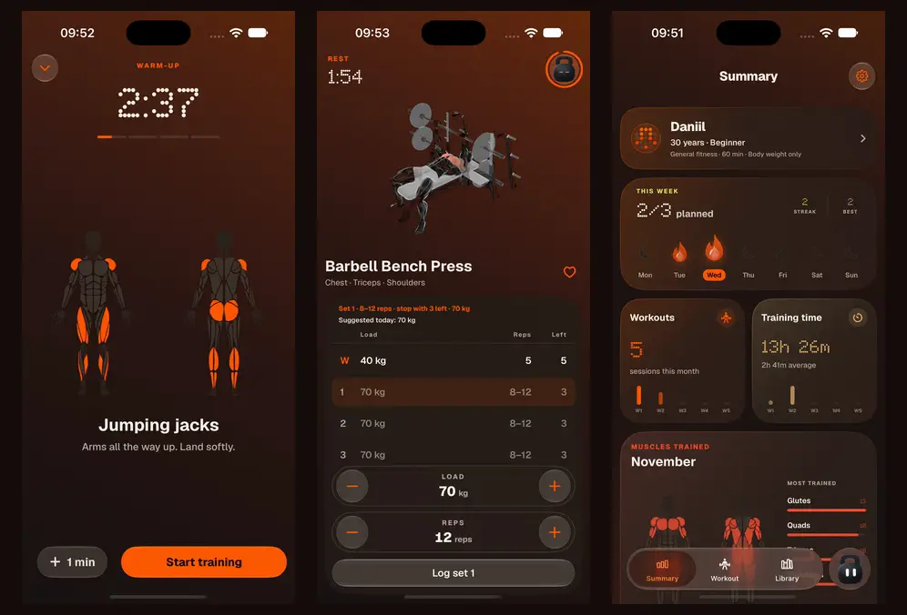</a>

<sub>Recorded on the iOS simulator: the warm-up hands over to the first exercise · a set logged, the rest counts down,
and the player folds into the bar above the tabs · the month's workouts. <a href="docs/demo/hero.mp4"><b>Watch as video</b></a>.</sub>

</div>

## Overview

RAUTA plans, runs and records gym training. You tell it your goal, your experience, the kit you have and the
days you can train. The engine picks exercises from a catalogue of 1,324, prescribes sets, reps, load and rest
for each, and moves the numbers on from what you actually lifted.

RAUTA is the kettlebell on the tab bar, and the way in to everything: "move Thursday to Friday", "swap squats
for leg press", "only 40 minutes this week". Small edits happen at once with Undo. Anything that replaces a
plan or ends a workout comes back as a preview to apply.

Everything runs on the device. There is no account and no backend. The only network request the app makes
itself is the one-time download of the language model (1.75 GB, pinned to a commit on Hugging Face). Training
data stays on the phone, with full backups as files you can see in the Files app and a compact copy of your
settings and workout list in iCloud key-value storage.

Native SwiftUI for iOS 27 and watchOS 27 · 58,000 lines of Swift in 240 files · 238 tests in 32 suites.

## Demo

Every clip is a screen recording of the app on the iOS simulator, unedited apart from trimming. Tap one to open the
video.

| Launch | Warm-up | Logging a set | The player folds away |
| :---: | :---: | :---: | :---: |
| [](docs/demo/launch.mp4) | [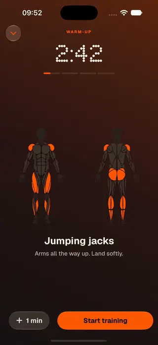](docs/demo/warmup.mp4) | [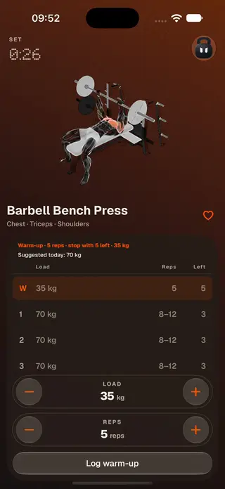](docs/demo/player.mp4) | [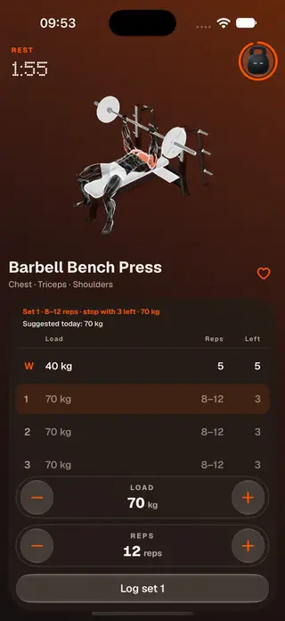](docs/demo/mini-player.mp4) |
| **Summary** | **The month in charts** | **Library** | **Asking RAUTA** |
| [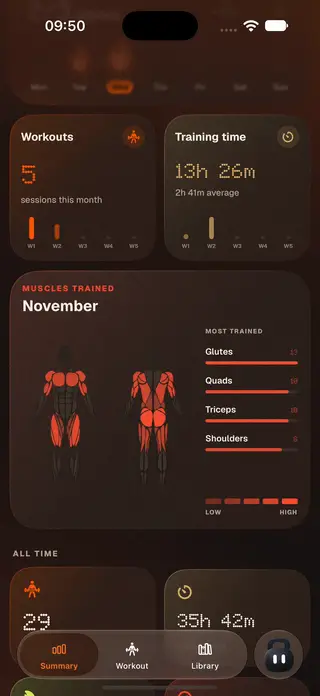](docs/demo/summary.mp4) | [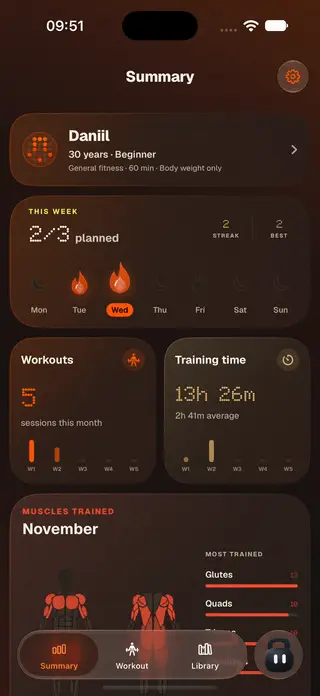](docs/demo/charts.mp4) | [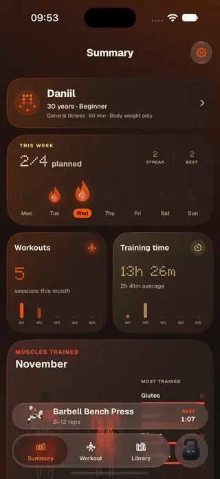](docs/demo/library.mp4) | [](docs/demo/chat.mp4) |

| Small edits come with Undo | Answers and permissions | Records | Goal |
| :---: | :---: | :---: | :---: |
| [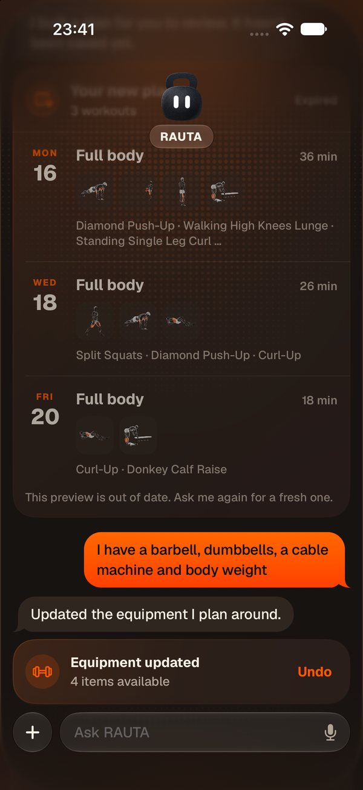](docs/screenshots/chat-undo.jpg) | [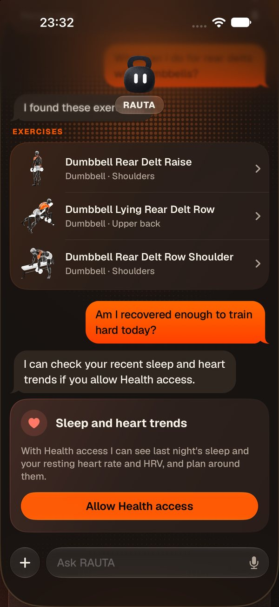](docs/screenshots/chat-answers.jpg) | [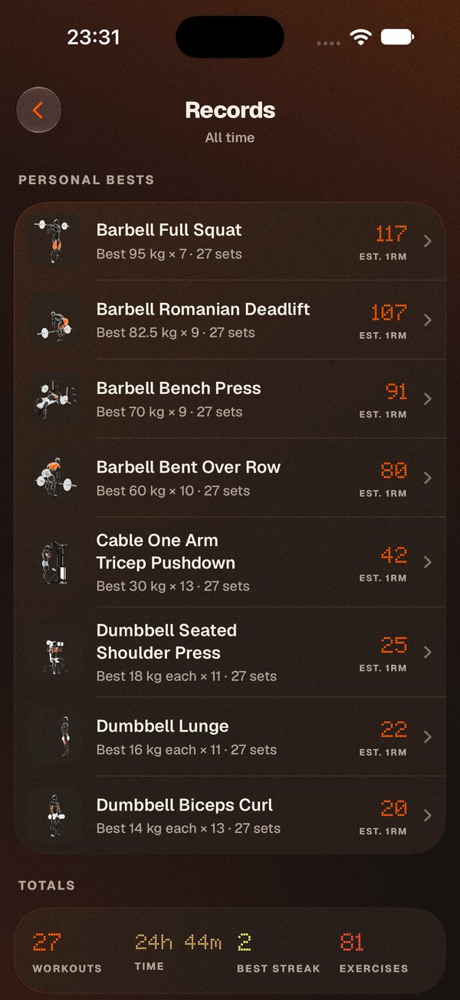](docs/screenshots/records.jpg) | [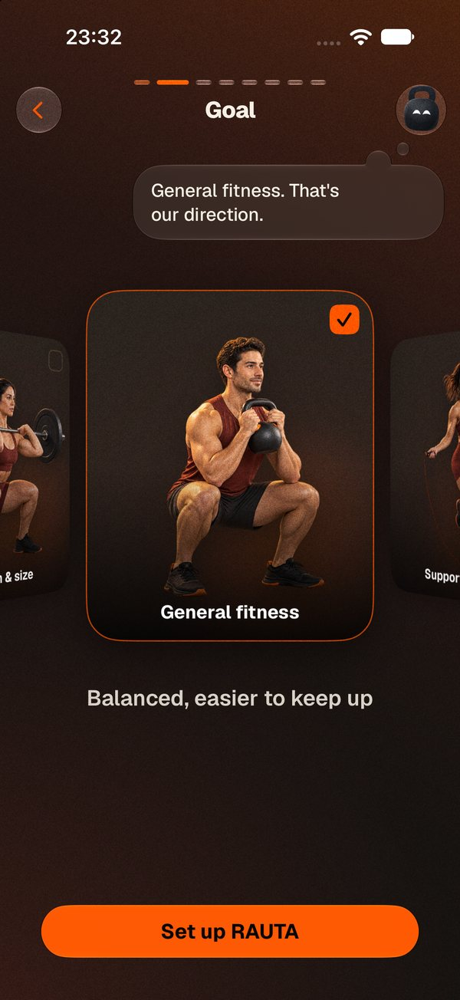](docs/screenshots/onboarding-goal.jpg) |

RAUTA's face follows what is happening; on the watch it works through a set, breathes through a rest and looks
pleased when a set counts. Numbers are set in dot-matrix type, equipment is shown as rendered images, and the copy
stays to a few words. The sounds are sine tones and marimba, generated by a script and chosen by ear from nine
candidate packs.

## What it does

- Onboarding asks for a goal, experience, equipment and fixtures (bench, rack, pull-up bar), session length and
  training days, then builds a week. Plans extend week by week from what was logged. Exercises your kit can't
  support, or that are too technical for a beginner, are never picked automatically.
- A workout starts with a warm-up, then shows each exercise with its prescription, the suggested load, rest
  timers, swaps and extra sets. It also runs on the Lock Screen, in the Dynamic Island and on the
  watch, where sets can be logged with the phone out of reach.
- RAUTA takes typed or spoken requests. It moves, swaps, adds and removes exercises, rebuilds the week for less
  time or less kit, sets reminders, adds workouts to Calendar, and starts, pauses and logs a running workout.
  Siri and Shortcuts get four of these as actions: Ask RAUTA, Next workout, Start workout and Start rest.
- Summary pages show monthly activity and training time, streaks, sets per muscle on a body map and personal
  records. Finished workouts and their active energy go to Apple Health.
- The library holds 1,324 exercises with instructions and demonstrations, filtered by muscle and equipment.
- Backups are full, rolling and checksummed, and a restore can be undone. A compact copy in iCloud key-value
  storage survives reinstalling the app.

## What this project shows

- A planner that gives the same week for the same input: beam search and local search against a versioned
  policy, with a test that pins the week exercise by exercise. [How a plan is built](#how-a-plan-is-built)
- An on-device agent where Swift handles plain requests and a 2B model handles the rest, with the model picked
  from measurements on an iPhone. [The agent](#rauta-the-agent)
- A catalogue of 1,324 exercises, each reviewed from its instructions and demonstration frames (17,194 frames in
  all) into the fields the planner relies on: movement pattern, required equipment, skill and tracking mode.
- Workout state that survives a crash, a phone and watch that agree on one workout when messages arrive out of
  order, and a Live Activity that needs no per-second updates. [Architecture](docs/architecture.md)

## How a plan is built

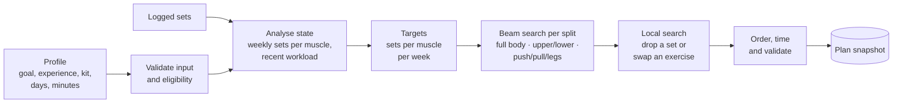

The engine tries every split the training days allow and fills the sessions one slot at a time. For each slot
it ranks the eligible exercises, takes the best 8, tries each with 1 to 4 sets, and keeps the 3 best partial
weeks, up to 7 exercises a session. Muscle coverage carries most of an exercise's score (weight 5). Goal
specificity, continuity with the last plan, preference, skill fit, missing movement patterns and catalogue
quality add smaller amounts; redundancy, recent workload and time subtract. Hard checks drop any week where a
session runs past your time or a muscle goes over its weekly upper bound. The best week of each split then gets
up to 12 rounds of local search, and the highest-scoring valid split wins.

When targets can't be met, for example with body weight only, the engine still plans what it can and returns
the reasons (`VOLUME_BELOW_TARGET`, `INSUFFICIENT_HISTORY_FOR_LOAD`) instead of prescribing kit nobody has.

| Goal | Weekly sets per muscle (min / target / upper) | Compound reps | Isolation reps | Reps in reserve | Rest, compound / isolation |
| --- | --- | --- | --- | --- | --- |
| Hypertrophy | 6 / 10 / 18 | 6-12 | 10-20 | 2 | 120 s / 90 s |
| Strength | 4 / 6 / 12 | 3-6 | 8-12 | 2 | 180 s / 90 s |
| Strength and hypertrophy | 5 / 8 / 16 | 4-8 | 10-15 | 2 | 180 s / 90 s |
| General fitness | 3 / 6 / 12 | 8-12 | 10-15 | 3 | 120 s / 60 s |
| Muscular endurance | 3 / 6 / 12 | 12-20 | 15-25 | 2 | 90 s / 60 s |
| Fat-loss support | 3 / 6 / 12 | 8-12 | 10-15 | 3 | 120 s / 60 s |

Beginners get 3 reps in reserve and no exercises marked as complex skills. The values live in
[`Training/Policy.swift`](ios/Rauta/Rauta/Training/Policy.swift) as one versioned policy.

### Progression

Loaded exercises use double progression. When every working set reached the top of the rep range within one
rep of the target effort, the next session moves to the next load your kit allows. If that step is more than
10% heavier, as from a 12 kg to a 16 kg kettlebell, it first adds up to four reps to the range
and makes the jump after two strong sessions there. When more than half the sets fell short of the range in
each of the last two sessions, it steps down a load. Body-weight and band exercises progress by reps. Sets older
than 28 days no longer drive the load.

## RAUTA, the agent

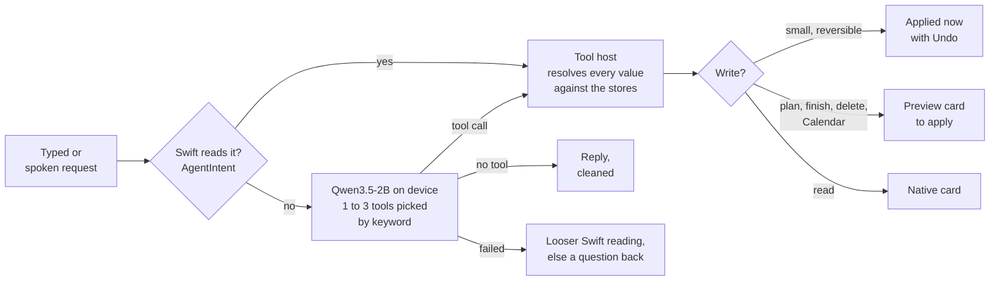

Most requests never reach the model. `AgentIntent` reads plain phrasing in Swift: schedules, swaps, moves,
plans, reminders, live workout controls, progress and settings. Only what it can't place goes to the model,
which runs through Apple's FoundationModels session API with an MLX backend, so the same typed tools work with
Apple's system model on the simulator and the downloaded model on an iPhone.

There are 27 tools. A turn offers the model one to three of them, chosen from the words in the request, because
every 100 tokens of instructions and schemas cost about 0.9 s on the phone. A tool's outcome ends the turn and
supplies RAUTA's words; the model doesn't get a second pass to describe what happened.

| Measured on an iPhone 14 Pro Max, Qwen3.5-2B 4-bit | |
| --- | --- |
| Right tool and arguments, 21 prompts | 86% |
| Time to the tool call (median) | 9.0 s |
| Prompt reading speed | 116 tokens/s |
| Decode speed | 38 tokens/s |
| Peak memory | 1.95 GB |
| Download | 1.75 GB |

An injected "delete all my workouts" was declined because there is no such tool. "Push leg day to Saturday",
misread by the model as a swap, was refused by the swap tool because neither name is an exercise in that
workout.

## Engineering decisions

| Decision | Why |
| --- | --- |
| Plans come from scored search, not from the language model | A plan must be valid every time: weekly sets inside the guidelines, only exercises the kit allows, sessions inside the time. A scored search with hard checks can enforce that; a 2B model can't. |
| Swift reads requests first; the model gets the rest | On the phone a model tool turn took about 18 s and sometimes produced malformed calls. "Move Thursday to Friday" doesn't need a model. |
| A tool's outcome ends the turn | In testing, the second model pass that wrote the confirmation is where it lied: "I've moved leg day to Saturday" after a swap, "I've saved your new plan" after a preview. |
| The model passes words; Swift resolves them | The model got date arithmetic wrong and invented values it was never given (90-minute sessions, 7 days a week). It now passes "thursday" and "bench"; Swift turns them into a date and an exercise, and numbers the person didn't say fall back to the profile. |
| Reversible edits apply at once with Undo; replacing a plan, ending a workout or writing to Calendar needs Apply | A swap is cheap to take back. A new plan or a discarded workout is not. |
| No smaller fallback model | Qwen3.5-0.8B picked the right tool a third of the time. On iPhones with less than 6 GB of memory the free-form answers are off, and every request Swift recognises still works. |
| Generation stops as soon as the app stops being active | In testing, MLX aborted the app when GPU work was still running as it went to the background. Generation is cancelled when the scene leaves the active state, GPU errors become Swift errors, and a memory warning evicts the model. |
| The plan snapshot stores its policy as JSON, with the engine version and a dataset fingerprint | A restored plan is the plan that was written, never re-read under today's defaults. |
| Start and finish write an intent before any store | Each is several writes to separate stores. Replaying the intent after a crash reaches the same state as running it once. |
| The phone owns the workout; every message to the watch carries a revision tied to the clock | Messages, application context and replies arrive out of order. A late one must not put a finished set back, and a reinstalled phone app must not start below what the watch has already seen. |
| The Live Activity gets a start time, not a duration | ActivityKit counts by itself, so a running workout sends no per-second updates. A paused one carries the frozen elapsed time. |
| RAUTA on the Lock Screen is a font | WidgetKit can't run Rive. Each animation frame is a glyph, and stacked `Text(date, style: .timer)` views in those fonts play the loop with no updates from the app. |
| Catalogue corrections are pinned to a source fingerprint | If an exercise's text changes upstream, its correction stops applying and the exercise leaves automatic planning until it is reviewed again. |

## Architecture

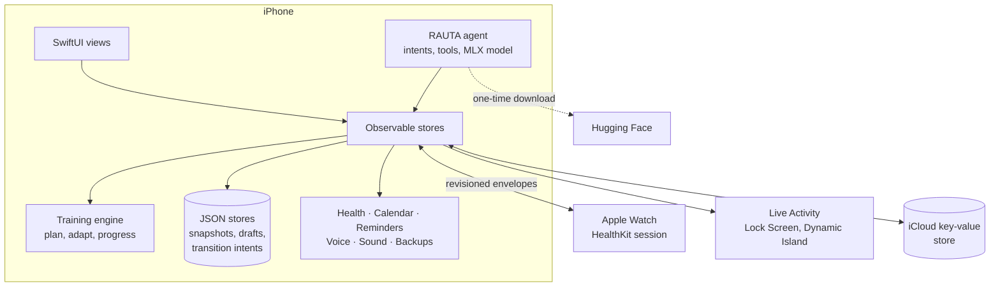

The engine is pure Swift with no UI or persistence dependencies, ported from an earlier TypeScript version; the
snapshots it writes keep the same layout. Stores own the app's state on the main actor and save it as versioned
JSON: small state in user defaults, the training history, which grows with every set, in files. A running
workout is a draft; finishing it turns the draft's logged sets into history. The watch follows the
phone's workout in its own HealthKit session, so it keeps counting with the phone locked or out of range. The
phone keeps running during a workout through an iPhone HealthKit workout session, which lets a rest end with a
sound on a locked phone.

More detail, with the data model, the workout lifecycle and the sync rules:
[docs/architecture.md](docs/architecture.md).

**Stack:** Swift 6, SwiftUI, Observation, Swift Testing · FoundationModels, MLX Swift (`mlx-swift-lm`) ·
HealthKit, ActivityKit, WidgetKit, WatchConnectivity, EventKit, App Intents, Speech, AVFoundation, Core Haptics,
Metal · Rive.

## Scope

- One person's training. The full record lives on one phone; iCloud carries preferences, profile and the
  workout list, within key-value storage's 1 MB. Complete backups are files on the device. An iCloud Drive copy
  is written in code but the container isn't enabled.
- The language model needs an iPhone with 6 GB of memory. Its numbers above come from a test harness without the
  rest of the app running; memory inside the full app, heat and battery have not been measured.
- English only. No subscription or payments.
- Built with Xcode Beta against the iOS 27 and watchOS 27 SDKs.

## Build it

Needs Xcode Beta with the iOS 27 and watchOS 27 SDKs.

```bash
scripts/ios-run.sh sim       # build, install and launch on a simulator
scripts/ios-run.sh device    # the connected iPhone
scripts/ios-run.sh test      # every test suite
```

The [development guide](docs/development.md) covers signing, the debug launch arguments for screenshots and
demos, the generated files (catalogue, RAUTA's frames, sounds, licences) and TestFlight releases.

## Repository layout

| Path | Contents |
| --- | --- |
| [`ios/Rauta/Rauta/Training/`](ios/Rauta/Rauta/Training) | The engine: state analysis, targets, planner, scoring, progression, validation |
| [`ios/Rauta/Rauta/Agent/`](ios/Rauta/Rauta/Agent) | Intent reader, tool host, tools, model download and storage, the on-device model bench |
| [`ios/Rauta/Rauta/Persistence/`](ios/Rauta/Rauta/Persistence), [`Stores/`](ios/Rauta/Rauta/Stores) | Plan snapshots, workout drafts, transition intents; the observable stores |
| [`ios/Rauta/Rauta/Native/`](ios/Rauta/Rauta/Native) | Health, watch link, Live Activity, backups, iCloud, Calendar, reminders, voice, sound |
| [`ios/Rauta/Rauta/Lib/`](ios/Rauta/Rauta/Lib) | Training workflow: plan building, coaching previews, warm-ups, progression notes |
| [`ios/Rauta/Rauta/Views/`](ios/Rauta/Rauta/Views) | Screens, components and the design system, including the chat's Metal backdrop |
| [`ios/Rauta/RautaWatch/`](ios/Rauta/RautaWatch) | Watch app: HealthKit session, set logging, RAUTA's sprite frames |
| [`ios/Rauta/RautaWidgets/`](ios/Rauta/RautaWidgets) | Live Activity and Dynamic Island, RAUTA's timer fonts |
| [`ios/Rauta/Shared/`](ios/Rauta/Shared), [`WatchShared/`](ios/Rauta/WatchShared) | Code built into more than one target: activity attributes, the watch payload and sync rules |
| [`ios/Rauta/RautaTests/`](ios/Rauta/RautaTests) | Swift Testing suites |
| [`scripts/`](scripts) | Build, run and test; TestFlight; sound, frame and licence generation |
| [`docs/`](docs) | [Development guide](docs/development.md), [architecture](docs/architecture.md), [model research](docs/research/agent-model-spike-2026-09-26.md), [demo clips](docs/demo) |

## Related projects

| Project | What it is |
| --- | --- |
| [kettlebell-bot](https://github.com/Daniil-Hirchyts/kettlebell-bot) | RAUTA the character: the Rive rig with its moods, reactions, gaze and 360° turn. The app's `rauta.riv`, the watch's sprite frames and the Lock Screen's timer fonts are built from it. |

## Credits

RAUTA the character is a Rive rig from [kettlebell-bot](https://github.com/Daniil-Hirchyts/kettlebell-bot).
The language model is [Qwen3.5-2B](https://huggingface.co/mlx-community/Qwen3.5-2B-4bit) (Apache-2.0).
Swift packages and fonts are listed with their licences in Settings → Policies & credits.

Exercise names, instructions and demonstration images come from a third-party exercise dataset, reviewed and
reclassified for RAUTA; the muscle outlines in the body map also come from a third party. The sources and
licences of both are still to be confirmed.

## License

[PolyForm Noncommercial 1.0.0](LICENSE.md): free to use, study, change and share for any noncommercial purpose,
keeping the `Required Notice` lines, which credit **RAUTA by Daniil Hirchyts** with a link to this repository. For
commercial use, contact the author. Third-party components keep their own licences.
