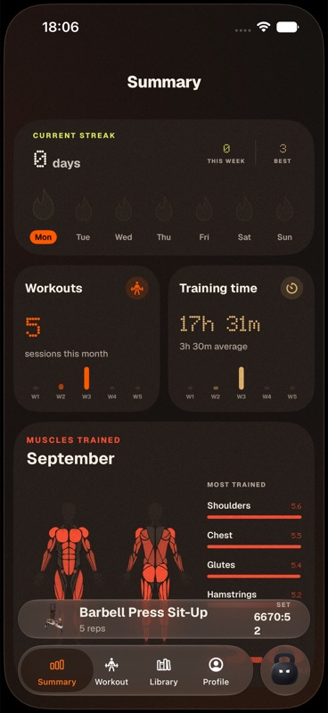
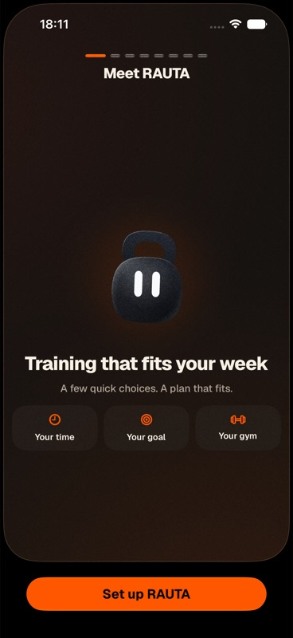

# RAUTA: make training feel guided, responsive, and alive

Implementation prompt and whole-app source review · 21 September 2026 · baseline commit `12d0bfc`

## How to use this document

Give this entire file to the implementation agent. Sections 1–3 explain the diagnosis and decisions; sections 4–11 are the implementation contract. Work in the phases below, preserving the native app and its training engine. Do not interpret this as permission to replace the product with a new UI kit or a web app.

**Evidence boundary:** this review covers the screen inventory, navigation, character system, workout lifecycle, planning operations, shared interaction components, Watch UI, and Live Activity code. The current app built successfully in the iPhone simulator. Only the Summary and onboarding welcome screens were visually verified. Simulator taps reported success without changing the UI, including after a restart; Device Hub accessibility timed out, and browser-mirror taps also had no effect. Consequently, the other screens and transitions have source-based findings, not completed visual or usability verification. Haptic quality, frame pacing, accessibility behavior, and physical-device ergonomics remain untested. Resolve that inspection problem in implementation phase 0; do not treat unsuccessful automated taps as proof that real users cannot tap the app.

The user's explicit visual anchors are the exercise player and the screen immediately before finishing a workout. Keep their identity. This document changes their connections and feedback more than their appearance.

## 1. Diagnosis: the missing link is visible cause and effect

RAUTA has personality assets and plenty of animation code. It does not consistently connect **my intent → Rauta's work → a visible result → my next useful action**.

The current main journey is fragmented:

1. Open Summary: streak, monthly counts, time, muscle map.
2. Discover the small Rauta action menu to create a plan or choose exercises.
3. Pick dates or exercises; some operations show only a small loader or a haptic.
4. The result appears elsewhere, often through a navigation reset.
5. Find a workout and open Rauta's menu again to start it.
6. Use a much stronger, focused exercise player.
7. Reach the attractive pre-finish screen.
8. Finish, close the player, and return to Summary without a dedicated saved-session receipt.

The proposed journey is:

1. Open **Train** and immediately see the relevant next action.
2. Ask Rauta for a plan, with understandable constraints and honest processing feedback.
3. See the actual result and why it fits; open the first workout directly.
4. Start from an obvious button; keep the existing player.
5. Log a set and see that exact set settle into the log, with progress and rest changing together.
6. Keep the pre-finish moment; finish deliberately and receive a durable saved-session result.
7. Leave with the next scheduled session visible. On return, the calendar and recorded work determine what has changed.

### Findings that should drive the work

| ID | Priority | Evidence and implication |
|---|---|---|
| F01 | P0 | `WorkoutsScreen.swift`, `mainTab = .summary`, `SummaryWorkoutsContent`: launch prioritizes retrospective statistics. The captured Summary confirms no main start/plan CTA in the content; an active session appears in a small accessory. Put today's training decision first. |
| F02 | P0 | `companionActions`, `summaryCompanionActions`, `workoutCompanionActions`: plan creation, manual creation, and workout start are exposed through the character's menu. A distinctive character is being asked to carry hidden essential navigation. Expose primary actions in their relevant content. |
| F03 | P0 | `RautaDirector.Beat` contains `line`, but the only beat subscriber is `RautaPerformer`; `hear(_:)` plays `beat.reaction` without displaying or announcing `beat.line`. `RautaThoughts` is a menu presenter, not a response feed. Build a bounded response surface tied to an operation/result. |
| F04 | P0 | `PlanWeekScreen.create()` has a button loader, then `.created` resets navigation to `.workouts` and discards the returned result details at the UI boundary. `AddExercisesScreen.buildWorkoutWithRauta()` and Summary's adjustment action can fail with a warning haptic only. Show useful pending, result, empty, and failure states. |
| F05 | P0 | `finishActiveWorkout()` signals success, closes the player, calls `finish()`, and selects Summary. `ActiveWorkoutStore.finish()` returns no result and uses `try?` for its finish intent. A new “Saved” receipt must first have a reliable commit result; do not simply add a celebratory screen after this call. |
| F06 | P1 | `OnboardingScreen` has eight stages; final “Start training” only completes onboarding and resets to the root. The stated action and next screen do not match. Complete setup into a useful training choice. |
| F07 | P1 | `WorkoutDestinationScreen` always asks where exercises go, even when `preferredWorkoutId` already identifies the originating workout. Keep the chooser for ambiguous library entry, bypass it for explicit add-to-this-workout entry. |
| F08 | P1 | `SummaryDashboard` and `ProfileDashboard` both emphasize workouts, training time, and streak-related totals. Profile mostly presents identity and records; editing lives behind Settings. Consolidate records in Progress and profile controls behind a labeled account entry. |
| F09 | P1 | `StreakBuilder.currentRun` counts consecutive calendar days with training. It tolerates today being unfinished, but a full rest day breaks the run. That is a poor lead metric for scheduled strength training. Lead with this week's planned sessions and actual completions. |
| F10 | P1 | `ActiveSetLog.save()` updates the record, resets the editor, starts rest, and sends a success haptic; there is no coordinated local saved-set transition. “Log set” and “Next exercise” use the ghost variant. Make the frequent action clear and its result local, brief, and interruptible. |
| F11 | P1 | `WorkoutDetailScreen.issue` is passed to `ConfirmModal`; ordinary start/swap/reschedule/copy failures lack a standalone inline issue presentation. `WorkoutDestinationScreen.add` catches with a haptic only. Review every error route for a visible recovery path. |
| F12 | P1 | `ActiveSetLog` displays and saves RIR, but has no RIR editor; `loadCurrent` can use prescribed/default RIR as an observation. Show optional observed effort explicitly; never present a prescribed value as the user's report. This also affects how trustworthy Rauta's reactions and later recommendations are. |
| F13 | P1 | Captured active accessory shows a very large set timer wrapping across lines. This is an existing long-running simulator session, not evidence of ordinary workout duration. Add readable long-duration formatting and a non-destructive “still training?” recovery state for stale sessions. Do not silently truncate or finish them. |
| F14 | P1 | Source accessibility risks include `xxxLarge` caps on statistics, small player controls, numerous fixed-size readouts, motion without a local Reduce Motion check, and notices far below their triggering setting. These need runtime testing; screenshots do not establish conformance. |
| F15 | P2 | `AppButton.ShakeEffect` stores interpolation in an `Int`; the setter rounds intermediate values, so its fractional progress is always zero. The intended shake cannot work as written. Fix continuous interpolation only if keeping the effect; explain unavailability with text first. |

P0 means essential to the proposed experience, not a measured production incident. The user has not supplied analytics or usability-study results.

### Strengths to preserve

- The dark warm palette, configurable accent, grain, rounded surfaces, cutout exercise media, body maps, and display typography have a recognizable identity.
- Native navigation/zoom transitions, source anchors, swipe-back, and the persistent exercise accessory already exist.
- Rauta already has Rive artwork, moods, reactions, touch attention, cue coalescing, stage leadership, and reduced-motion handling. Extend these; do not introduce another animation engine.
- The player and pre-finish view put a single activity at the center. Their focused composition should influence the new Train card and result receipt.
- Planning runs off the main actor. Immutable program records, workout transition recovery, structured set logs, load semantics, and substitution rules are valuable foundations.
- Library and builder already share browsing components while isolating their query state. Keep that separation.
- Watch and Live Activities already support continuity, and rest is based on a persisted deadline. Preserve those contracts.

## 2. Applying the supplied expert notes selectively

The two supplied transcripts are design lenses, not proof that any specific intervention will improve this app's retention. Test the resulting behavior with people.

| Expert principle | RAUTA implementation | Misapplication to avoid |
|---|---|---|
| Goal-gradient effect | “2 of 3 planned sessions this week”; set/exercise progress with an accurate denominator; short setup progress. | Invented percentages, counting skipped work as completed, or progress bars everywhere. |
| Peak-end rule | Preserve the player's strong moments; improve the last set, pre-finish → saved receipt, and first plan result. Make failures recoverable. | A celebration before persistence succeeds, or mandatory animation after every set. |
| Visible effort / labor illusion | Show the actual input constraints, a real operation state, and a result explanation based on engine output. | Artificial delay, invented stages, fake percent complete, or implying remote AI work. |
| Isolation effect | One visually dominant next action per state; use the user's accent for that action and the changed result. | Equal emphasis for every card or a permanently moving mascot competing with the workout. |
| Choice overload | Three useful destinations, contextual add flows, optional advanced settings, and one recommended next step. | Deleting useful capabilities or hiding the Library to hit an arbitrary screen count. |
| Autonomous change / tick-tock | Planned dates become relevant as time passes; a completed week becomes a reviewable recap; rest becomes ready. | Expiring exercise access, arbitrary rewards, fake recovery scores, or punishing time away. |
| Open loop / anticipation | End a workout with the next planned session and what is already known about it. | Withholding an already available result until tomorrow or promising background analysis that never runs. |
| Build loops | Plan → train → record → understand → next scheduled session. | Points, pet care, daily spin wheels, boss battles, or a separate engagement economy. |
| Notifications support value | Existing rest alerts remain meaningful; optional scheduled-session reminders may reference an explicit user schedule. | Generic “come back” messages or making push permission necessary to benefit. |

The app is a training companion. Success is confident, sustainable training with low logging friction, not maximum app opens or daily exercise pressure.

## 3. Challenge log: decisions reconsidered before handoff

These are four desk-review passes against the source, user request, and constraints—not independent user tests.

| Pass | Initial proposal | Challenge | Final decision |
|---|---|---|---|
| 1 — Information architecture | Two tabs, everything under Today and Progress. | Manual workout builders and people researching exercises would pay extra navigation on every browse. A large catalogue is a distinct task. | Three tabs: Train, Library, Progress. Profile becomes an account sheet. Workout management stays easy to reach under Train. |
| 1 — Screen count | Replace all full-screen selectors with sheets. | Muscle maps, equipment grids, long destination lists, and multi-step forms need room. Fewer screens can produce more crowding. | Keep task-sized editors; remove only redundant decisions. Use a compact sheet for truly small inputs such as a preset name. |
| 2 — Character | Give Rauta a speech bubble and reaction on every tap. | The player has high-frequency inputs; repeated character speech would compete with exercise media and logging. | Local feedback for ordinary actions; one contextual Rauta response for planning, session start/end, meaningful changes, and recovery. |
| 2 — Visible work | Animate three planning stages for a minimum of two seconds. | Existing operations may be instant or take longer; staged animation would misrepresent computation and add delay. | Start feedback immediately, use indeterminate real work, and show an immediate result when ready. Add stage labels only if real callbacks exist. |
| 3 — Retention | Daily challenges or a “recovery ready” countdown. | No validated recovery model or backend; training every day is not the product's goal. | Start with schedule/date changes and weekly reflection, computed from real local records. Rest days are successful states. |
| 3 — Ending | Automatically finish after the last set. | Sets and exercises are different states; users may add sets, correct logs, or finish a partial session. | Preserve deliberate finish. Morph the existing pre-finish surface into a saved receipt only after commit. |
| 4 — Scope | Rebuild navigation, all animations, onboarding, and engagement in one change. | Large simultaneous changes obscure whether the core problem improved and risk session recovery. | Ship a complete narrow feedback loop first, then restructure navigation, then improve time-aware return states. Each phase has a validation gate. |
| 4 — Trust | Add a “Saved” banner to the current finish handler. | Current finish API suppresses an error and returns no receipt. Cosmetic confirmation may be false. | Introduce a verified finish outcome before new celebration; retain the draft on failure and preserve replay/idempotency. |

## 4. Implementation-agent prompt

You are improving the existing native RAUTA SwiftUI app in this repository. Implement the behavior specified below in phases. Before editing, re-read repository instructions and verify current symbols, since the source may have changed after this audit. Preserve unrelated user changes, including the pre-existing change to `ios/Rauta/Rauta.xcodeproj/project.pbxproj` at audit time.

**Outcome:** a person can tell what to do next, see that an action worked, understand what Rauta changed, and leave a workout feeling that it was recorded and that the next session is organized.

**Keep:** SwiftUI, the existing offline engine and data model contracts, Rive asset `Media/rauta.riv`, existing palette/accent choices, exercise media, body maps, strong player/pre-finish composition, Health/Watch/Live Activity behavior, recovery, import/export, and manual workout creation.

**Do not add:** a backend, chatbot, LLM dependency, subscriptions, social system, points economy, punitive daily streak, fabricated scarcity, invented readiness score, generic dashboard redesign, or large third-party animation framework.

Use existing `Theme`, `AppShell`, `RautaScreen`, `AppButton`, native glass styles, zoom sources, and actor boundaries. New type names below are suggested responsibilities, not a demand for a separate framework. Avoid making `WorkoutsScreen.swift` larger by accumulating every new feature in it.

### 4.1 Navigation contract

| Destination | User question | Contents |
|---|---|---|
| **Train** — default | What am I doing next? | Contextual primary card, current week schedule, concise Rauta explanation, All workouts link, explicit creation entry. |
| **Library** | What is this exercise, and what can I use? | Existing search, muscles, equipment, favorites, exercise detail and contextual add. |
| **Progress** | What have I actually done? | Completed history, weekly/monthly summaries, muscle map, records. Profile totals merge here. |

Profile/account is an explicit, accessible person button on Train and Progress, opening a sheet with training profile and Settings. Preserve all existing preferences. Health eligibility must have a clearly labeled path distinct from Apple Health permissions; it currently appears within the Experience flow and in a planning block route.

Do not keep a fourth/fifth tab-shaped character command. Move Rauta into Train's contextual card and into operation/result surfaces. Secondary actions belong in labeled “More” menus near the object they affect. The character may still be touch-responsive, but no essential action requires discovering that it is tappable.

Keep standard tab selection behavior. Do not animate a whole page sweep on every tab switch. Keep a persistent active-workout accessory across destinations; opening it resumes the same session/player. Push workout and exercise details from stable sources; preserve native back, dismissal, and focus restoration. Do not introduce a parallel custom navigation stack.

### 4.2 Train state priority

Derive this from domain records and an injectable clock, not from a second persisted copy of the workout state. Apply the first matching row.

| State | Main content and primary action | Secondary action / Rauta tone |
|---|---|---|
| Active session, including paused | Workout name, progress, paused/running state; **Continue workout** opens current player or completion review. | View workout. Rauta focused/calm; explain that the saved draft remains. No invitation to start another session. |
| Just committed session, receipt still open | Saved receipt described below. | Done returns to Train. No new workout promotion over the result. |
| Eligible scheduled workout today | Name, estimated duration labeled as estimate, focus, progress if applicable; **Start workout**. | View details; More → reschedule. If several sessions exist, recommend earliest explicitly and show the others. |
| An older uncompleted workout needs attention | A neutral “Your schedule changed” card, with **Review schedule**. | Keep as planned / choose a new date / leave for later. Never auto-delete, backdate completion, or silently regenerate. |
| No session today, future schedule exists | “No session planned today”; next date and workout. **View next workout**. | Build a workout remains available without suggesting training is obligatory. Use “Rest day” only when the schedule actually identifies one. |
| No plan and no active session | Friendly explanation of the value; **Plan my training**. | “Build my own workout” stays visible. Show prerequisites if automatic planning is unavailable. |
| Planning unavailable for profile/constraints | Plain reason; **Build my own workout** or the appropriate input-fix action. | Review answers. Never encourage someone to alter truthful health answers to unlock planning. |
| Plan finished / no remaining scheduled sessions | This plan's actual completion summary; **Plan next sessions**. | View history. If uncompleted sessions remain, use the schedule-review state instead. |

Today, upcoming dates, and one short result/insight can coexist, but there must be only one filled primary CTA in the first viewport. Upcoming schedule is compact; “All workouts” retains the full existing list. Default that list to useful date order: upcoming nearest first, history newest first. Put type filters behind a filter control rather than showing a long strip of all available types. Do not infer workout type from the visible title long-term; the current prefix-matching behavior is fragile for renamed workouts.

### 4.3 Onboarding

Preserve the welcoming character and visual controls. First fix the misleading endpoint, then reduce optional questions.

- Welcome → essentials → training preferences → gym → review → choose dates/create first plan. The number of actual pages can differ from these conceptual groups; do not compress complex controls into an unreadable form.
- Name and priority muscles are optional. Offer an explicit Skip/Not now where appropriate, with balanced priorities as the real supported default.
- Keep age/eligibility and experience inputs required wherever the engine requires them. Do not discard health gating in pursuit of fewer steps. Explain manual planning availability before a later failure.
- Show actual step count and back navigation. Do not show a percentage of “profile completeness” that pressures collection of unnecessary data.
- Review primary label is **Choose training dates**, or **Build my own workout** for a manual-only path. A plan is not ready until generated.
- Returning installs bypass onboarding as today. If the user leaves onboarding unfinished, preserve entered answers; never wipe existing records to show a new welcome flow.
- Avoid silently preselecting next Monday/Wednesday/Friday, particularly when the user wants to train today. Offer a clearly labeled suggestion using available profile constraints and editable dates. Do not add sessions the user did not select.

### 4.4 Planning and Rauta's visible work

Use one operation lifecycle for Create plan, Extend plan, Adjust remaining plan, Propose workout, Regenerate proposal, and Copy workout when engine work is required:

`idle → running → succeeded(result) | blocked(reason, fix) | failed(error, retry) | cancelled`

Each operation needs a stable ID and captured input snapshot. Disable only conflicting submit actions. A second tap must not create a second plan. Navigating away or changing inputs invalidates the old result according to the operation's cancellation rules. Never let a stale response overwrite a newer request.

**Running:** show Rauta beside the request, in an existing `.thinking` or `.working` mood, with one truthful line such as “Building around your equipment and selected dates.” Keep selected dates, goal, duration, and equipment summary visible as evidence of personalization. Use an indeterminate activity indicator. Do not show numerical progress without measured progress. If the engine exposes real stages, show them; otherwise one honest state is enough.

**Fast result:** skip a loader flash and reveal the result immediately. Never impose a minimum wait. Animation can continue decoratively after the result is already actionable.

**Created result:** remain in context with “Your plan is ready,” the actual dates/session count, estimated durations, focus, and at most two facts supported by the result, for example “Uses your saved equipment.” Primary **View first workout**, secondary **View schedule**. Use the `programId`, `sessions`, and `issues` returned by `TrainingWeekOutcome.created` rather than throwing them away in a navigation reset. Explain meaningful planning issues in ordinary language; do not render internal diagnostics wholesale.

**Important API distinction:** `createTrainingPlanForDates` already saves and projects the plan. Its result is a saved result, not a preview. Do not add a “Use plan” button that saves it again. If implementing review before changing an existing plan, split generation from commit first.

**Adjust existing plan:** show what will change and what remains completed. `generateAndSavePlan` currently commits immediately; use the existing generation layer (`planTrainingWeek`) to produce a candidate before an Apply changes action if adding preview. Preserve completed sessions, active drafts, manual overrides that the engine contract protects, and revision lineage. Validate input/source versions again at apply time. Result says exactly what changed, including “No changes needed” when the result is equivalent. Never imply adaptation happened overnight automatically.

**Blocked/error:** preserve selections and render the reason beside the operation. Offer the relevant existing editor and a route back with the request intact. Generic failures offer Retry and Cancel. No haptic-only failures, sad-character-only explanation, or “success” on a no-op.

**Cancellation:** the first version may cancel when the operation surface is dismissed. Say “Plan wasn't saved” only when that is true. Check cancellation before commit and do not show a cancelled state if the commit already succeeded. Do not promise background processing unless a real resumable operation is implemented.

### 4.5 Workout creation, editing, browsing

- From an explicit workout “Add exercises” action, carry a typed context with the target ID through picker → detail → return. CTA says **Add N exercises to [workout]**, commits once, returns to that workout, and briefly identifies the added rows.
- From Library, target is genuinely ambiguous: keep a destination chooser. If creating a new workout and no other destination exists, proceed directly to the new-workout review. Show the proposed destination before committing. Never silently add to a running workout solely because one happens to exist.
- Reuse current filters and isolated browse state. Preserve search, scroll position, and selection when opening details, changing filters, and coming back.
- Search/filter empty states need real Clear filters and Clear search actions; the current generic filter-empty case offers advice without a direct action. Preserve unrelated selections when clearing one filter.
- Give selected exercise cards a visible selected state, count, and a small check transition. Never animate the whole grid on each selection or search keystroke.
- Retain full-screen body/equipment selectors when their density needs it. Keep advanced load increments under equipment; show what “kg each” versus total means. A preset-name prompt can be a compact sheet.
- Replacement should return to the same row and reveal the new exercise in place, with “Replaced X with Y.” Use existing substitution validation, including the restriction on replacing planned exercises with logged sets. Do not implement blanket Undo unless it can safely restore the entire domain change.
- Reordering stays native and accessible through Move up/down actions. Removal must keep existing data protections and confirmations where relevant; do not silently discard performed work for an animation.
- Add explicit pending labels to proposal regeneration and engine-backed save/copy. Display failures in the screen that owns them. A delayed success must not navigate away from newer user work.

### 4.6 Player and set/rest interaction

Keep the existing hero exercise media, gradient/grain background, compact set table, and primary composition. Improve feedback locally.

1. **Press Log set:** immediate native press feedback; persist using the existing set ID. Lock that submission while it is in flight without blocking load/reps adjustment longer than needed.
2. **Commit succeeds:** mark the exact row recorded, change its check/fill briefly, update the progress label, and expose the next editable set. Start rest from the committed domain event. One haptic, if enabled.
3. **Rest:** show an easily read remaining time and a distinct REST label. Add **+30 sec** and **End rest** only with authoritative deadline updates shared with `RestAlerts`, Rauta, Live Activity, and Watch. Ending rest must not complete a set.
4. **Rest expires:** one transition to “Ready when you are,” not a modal or repeated vibration. No automatic set logging or forced workout advancement.
5. **Exercise complete:** one compact acknowledgement and explicit **Next exercise**. Update exercise name/media and progress in a coordinated transition; keep controls usable. All sets logged is not identical to all exercises marked complete.
6. **Last exercise:** use the existing pre-finish screen. It remains possible to review/add work before finishing.

Make Log set / Next exercise visually primary; reduce competing favorite/menu emphasis. Increase physical hit areas without inflating every visible icon. Give the player a visible close/minimize control as well as drag-to-dismiss and VoiceOver escape.

Corrections matter: saving an edit to an already-recorded set must say **Update set**, not count as a new set or restart rest by default. An Undo/Edit affordance must reference the committed set ID. Rapid double taps, logging from Watch, and changing exercise during feedback must not duplicate or misattribute records. The next exercise must load its own editor values; verify identity and `onChange(exerciseId)` behavior rather than relying on `onAppear`.

RIR is optional observed effort. Provide a compact explanatory input (“How many more reps could you have done?”) without a mandatory extra screen per set. Keep the prescribed target separate. Unknown observations stay unknown; do not autofill a target into the historical observed value. Preserve resistance modes, assisted loads, per-implement basis, unilateral side, warmup/working set types, and existing load increments.

For old active sessions, use an explicit review prompt after a configurable, tested inactivity threshold based on last meaningful activity. Resume / review and finish / stop are deliberate actions. Preserve the draft and raw timestamps. Format long durations as hours/minutes so the accessory never wraps into nonsense. Do not “fix” old history by rewriting it automatically.

### 4.7 Finish, receipt, and next session

Keep the current pre-finish composition and clear Finish workout action. After the person taps it:

- Capture the session identity and proposed duration once; perform the existing recoverable finish transaction.
- Expose a reliable finish outcome, ideally a committed session identifier/receipt or a typed failure. Success must mean the local durable records are present and consistent. Investigate swallowed write errors along this path; an in-memory change alone is insufficient.
- Only after success, replace the pre-finish content with a **Workout saved** receipt using the same visual family. Rauta is proud; one brief celebration plays once for that completion event. A normal revisit to history does not replay it.
- Show 2–3 actual facts: completed sets/exercises, recorded duration, and a factual comparison only where comparable history exists. Do not count skipped exercises, planned sets, or absent observations as performed work. Partial sessions get “Session saved” and their actual work, not “Everything complete.”
- Primary **Done** returns to Train. Secondary **View session** opens durable history. Sharing is optional and subdued.
- Show the actual next scheduled session/date if one exists. Otherwise “Plan next sessions” is optional; do not invent tomorrow's workout or hold the receipt hostage to planning.
- Separate local saved state from optional Health/iCloud synchronization. A sync failure must not imply the local workout was lost or trigger another finish transaction. Render a nonblocking status with retry where supported.
- On failure, keep the session/draft recoverable, explain the issue, and allow retry. Do not close the player, announce success, or lose the last set.
- If the app dies after commit but before the receipt appears, reopening must not double-save. Recover the real state and optionally offer the receipt using its durable session ID.

**Make a better ending without adding a compulsory new workflow:** use a state of the existing completion surface for the receipt, not a multi-page “rate, share, invite, schedule” sequence.

### 4.8 Progress and return visits

Merge Summary statistics and Profile records into Progress. Lead with a chosen period and a useful observation; retain muscle maps and a clear history link. Do not add a new “insights feed” that repeats the same generic encouragement.

- Distinguish recorded set volume from legacy exercise-based estimates. Current heatmap fallback and precise values have different meanings; label estimates and explain units instead of showing both as equivalent “sets.”
- Deduplicate legacy workout completions and structured sessions by stable references when aggregating. Existing `max(count)` and fallback duration rules need mixed-history fixtures before new progress claims.
- Do not fabricate personal records. Compare only compatible exercise/resistance/basis/context and enough real data. If no fair comparison exists, show the raw accomplishment.
- Replace the prominent daily streak with **This week's training**. For a plan: “2 of 3 planned sessions completed,” with completed, upcoming, moved, and uncompleted states. Extra/manual sessions get separate credit without silently changing the original planned denominator. Rescheduling must not erase the historical truth of a past week.
- For users without a plan: show “2 sessions this week”; never divide by an invented goal or call them behind. A user-set frequency goal could be a later option.
- A weekly recap becomes available when the real local calendar period closes and enough data exists. Compute it on foreground/open if needed; phrase it as a review of recorded work, not as a report Rauta secretly produced in the background. Keep prior recaps accessible; nothing expires.
- A rest/no-session day has its own useful state: next scheduled date, recent accomplishment, optional browsing. Rauta does not become disappointed by absence.

Time model:

| Event | Real transition | Display / persistence |
|---|---|---|
| Date crosses a planned session day | Future → today → uncompleted past, unless recorded/rescheduled | Recompute on launch, foreground, local date/time-zone change, and local midnight while visible. No server required. |
| Rest deadline passes | Resting → ready | Use the existing absolute deadline. Reconcile on foreground; do not restart the countdown from view appearance. |
| Week closes | Current period → reviewable past period | Use an explicit local calendar/week policy; use the same policy for counts, dates, and recap IDs. |
| Session commits | Active → recorded; next session becomes primary | Use durable records and stable session IDs; publish feedback once. |

Scheduled training dates are local date-only values. Rest deadlines are instants. Do not reinterpret a selected day by truncating a UTC timestamp. Test DST, travel/time-zone changes, Monday boundary, and an app left open overnight. Persist user choices, dismissals, and receipt/recap acknowledgement IDs where needed; derive time-dependent presentation from the clock and domain state. Do not run background polling or generate random “new” content merely to change the screen.

Optional session reminders are a later phase: opt-in, refer to chosen dates/times, reschedule/cancel with the plan, avoid duplicates, and work when notification permission is denied. Keep the primary return loop useful with notifications off. Do not add this scope until the foreground experience works.

## 5. Rauta behavior contract

Rauta should have a job in each placement. It can react to a touch for charm, but its most noticeable actions should explain training events.

| Context | Behavior | Visible language |
|---|---|---|
| Train, nothing urgent | Calm presence; occasional subtle idle if motion allowed. | One context-derived line, not a fresh generic phrase on every render. |
| Planning running | Existing thinking/working state, anchored beside operation status. | “Building around your equipment and selected dates.” |
| Plan created | Small happy/acknowledge or brief celebrate, once. | “Your 3-session plan is ready.” Count comes from the result. |
| Plan revised | Acknowledge and direct attention to changed rows. | “Updated the 2 remaining sessions.” Only if those changes really occurred. |
| Ordinary set commit | Primarily row/check feedback; no large mascot overlay. | “Set 2 saved” when useful; accessible announcement once. |
| Rest ready | Small attention cue, still pose under Reduce Motion. | “Ready when you are.” |
| Workout committed | Existing proud/celebrate, once and dismissible. | “Workout saved.” |
| Failure or blocked plan | Calm/blocked, with explanation and recovery beside it. | “I couldn't build a plan with these choices.” Specific fix below. |
| Return after time away | Friendly context of next session; no scolding. | “Your next session is Wednesday.” Only when scheduled. |

Reuse `RautaDirector` for personality and cue coalescing, but add explicit **operation state** for work that begins before store mutations. Store diffs alone cannot represent “building,” cancellation, or a failure. Keep personality separate from authoritative mutation: an animation event must never be what saves a workout.

Provide a small response presenter tied to the owning surface, not a global queue of popups. Priority is failure/action-needed → committed completion → current operation → optional ambient greeting. Only one speaks at a time; never cover active inputs. Persistent results/errors stay readable until dismissed or acted on; optional acknowledgement can fade without carrying essential information.

Deduplicate domain events and haptic-derived generic confirmations. The current Next exercise path can signal success in both the control and callback; consolidate the trigger. Keep one on-stage leader and stop offscreen/background animation. Replayed/imported records must not cause a celebration storm. Make the behavior work with haptics/sound off and missing Rive artwork.

Revise overly presumptive copy such as “Nothing left in the tank. Nice.” It is inferred from effort data, not direct knowledge of how the person feels. Favor acknowledgement of recorded work over rewarding exhaustion. Avoid implying Rauta independently diagnoses recovery, pain, or readiness.

## 6. Motion, tactile feedback, and accessibility

These timings are starting design targets, not claims of measured performance or mandatory Apple values. Reuse native behaviors where they already feel right; do not layer custom scaling over an interactive native glass press.

| Interaction | Intended normal motion | Reduced Motion / equivalent |
|---|---|---|
| Press on custom plain card | Restrained 0.98 scale or fill change, about 100–160 ms; immediate action. | Fill/contrast change; no scale. |
| Selection/check | Local check/fill about 120–180 ms; optional selection haptic. | Immediate check and label change. |
| Saved set → next/rest | Changed row and status transition about 160–220 ms, no whole-screen movement. | Immediate content or short opacity fade; same text confirmation. |
| Exercise change | Small content fade/translation about 180–240 ms; maintain stable controls and media space. | Fade or immediate swap; never autoplay a large zoom. |
| Plan result | One cohesive reveal about 200–280 ms; no progressive unlock of usable content. | Immediate result plus optional short fade. |
| Push, sheet, player expansion | Existing native source-aware navigation; system owns interactive reversal. | Respect system settings; avoid extra custom movement. |
| Workout saved | One optional 600–900 ms character beat, all buttons usable immediately. | Still proud pose, check, and saved text. |
| Timer ticks / typing / repeated steppers | Stable digits and immediate content; no per-second pop or entrance stagger. | Same. |

Do not convert every property change into a spring. Use movement to indicate origin, changed state, or destination. Prefer opacity/transform for custom decorative motion; SwiftUI layout animation needs measurement on target devices rather than copied CSS rules. Slow-motion recordings can diagnose coordination, but evaluate daily logging at normal speed.

Accessibility requirements:

- Essential state is visible text and accessible semantics; never only color, motion, a mascot expression, sound, or vibration.
- Support Reduce Motion across the player, completion transition, check drawing, text swaps, and any new component. Existing partial support is not permission to assume global support.
- At accessibility text sizes, reflow cards, set controls, and metric layouts; do not just cap Dynamic Type or shrink every label. Avoid horizontal truncation of names, units, errors, and CTAs.
- Target at least 44×44 pt on iPhone controls, verifying actual hit bounds; the current visible player icons and chromeless heart are smaller. Keep controls reachable above the home indicator and keyboard.
- Expose progress as “Exercise 3 of 5; set 2 of 3 recorded,” selected/unavailable states, and explanatory disabled reasons. Avoid a button that merely shakes or says “Unavailable.”
- Announce a completed save or blocking error once; never announce every timer tick. Move focus deliberately when the player changes to a receipt; restore it to the originating control on dismissal.
- Maintain VoiceOver escape and visible close alternatives. Test menus, picker selection, reorder actions, and body-map selection without relying on gestures alone; provide a labeled list alternative where map targets are hard to reach.
- Check contrast in light/dark, custom accents, increased contrast, and reduced transparency. Preserve branding, but use color-independent selected and error states.
- Preserve existing sound/haptic settings. Use haptics for a meaningful confirmation, not every rerender; avoid duplicate app + native feedback.

## 7. Screen-by-screen disposition

All rows were reviewed from current source. Only rows explicitly marked V have accepted runtime screenshots. S means source review with runtime visual/interaction verification blocked in this run.

| # | Existing surface / health | Decision and required change | Evidence |
|---|---|---|---|
| 1 | Summary — weak entry hierarchy | Move retrospective content into Progress; create Train as default. Preserve body map and art direction. | V, screenshot 01; `WorkoutsScreen`, `SummaryDashboard` |
| 2 | Workout list — useful but indirect | Keep as All workouts under Train; compact today/week overview above it; explicit creation. Improve history ordering and date-state distinctions. | S, `WorkoutListContent`, `WorkoutTimeline` |
| 3 | Profile dashboard — duplicates records | Merge Records into Progress; account sheet owns editable identity/preferences. Retain personality without a redundant destination. | S, `ProfileDashboard` |
| 4 | Library — strong capability to retain | Keep its tab; preserve filters/query state; clearer empty-state recovery and add context. | S, `LibraryScreen`, `ExerciseBrowser` |
| 5 | Welcome — coherent brand, long journey ahead | Keep mascot and promise; simplify optional setup and truthful endpoint. | V, screenshot 02; `OnboardingScreen` |
| 6 | About / Experience / Goal / Priorities / Duration / Gym / Ready — mixed | Keep effective controls, explicit optional skips, visible eligibility/manual path, review → real next action. | S, `ProfileStepFlow`, `ProfileControls` |
| 7 | Plan dates / extend — feedback gap | Keep calendar selection; clear suggestions and real operation/result state. | S, `PlanWeekScreen` |
| 8 | Adjustment action — hidden and quiet | Place by schedule; show pending, reviewed changes, committed result, and recoverable errors. | S, `summaryCompanionActions` |
| 9 | Exercise picker + muscle/equipment filters — useful density | Keep shared browsing; context-aware commit and selection feedback. | S, `AddExercisesScreen`, `ExerciseFilterPage` |
| 10 | Workout destination — sometimes redundant | Bypass when origin already specifies target; retain when genuinely choosing among workouts. | S, `WorkoutDestinationScreen` |
| 11 | New / proposed / edit workout — adequate function, weak pending state | Keep review/order/date; add progress/error labels and visible changed result. | S, `WorkoutFormScreen` |
| 12 | Workout detail + date picker — hidden start, silent-error risks | Visible Start/Continue; More for copy/share/delete; keep calendar and domain checks. Add independent inline issue surface. | S, `WorkoutDetailScreen` |
| 13 | Start countdown — useful optional preparation | Preserve cancel; show labeled Start now. Do not add more startup ceremony or delay active-draft resume. | S, `WorkoutStartCountdown` |
| 14 | Active overview + compact accessory — valuable continuity | Preserve the same session everywhere; clarify phase and long durations; obvious resume. | S; accessory also V in screenshot 01 |
| 15 | Exercise player + set log — user-approved visual anchor | Keep design; local set acknowledgement, observed effort, readable rest, accessible close and controls. | S, `ActiveExerciseDrawer`, `ActiveSetLog` |
| 16 | All exercises complete — user-approved emotional anchor | Keep composition and deliberate finish; connect to verified saved receipt. | S, `CompletedWorkoutDrawer` |
| 17 | Post-finish / completed detail — weak closure | Add receipt state and durable re-entry; distinguish partial/saved/synced. | S, `finishActiveWorkout`, completed detail branch |
| 18 | Exercise detail — useful reference | Preserve media/instructions/favorites; adapt CTA to origin and return to the current player/picker context. | S, `ExerciseDetailScreen` |
| 19 | Alternatives — useful constraints, abrupt result | Keep current restrictions, show result at destination, retain filter and empty-state clarity. | S, `ExerciseAlternativesScreen` |
| 20 | Settings — broad but appropriately secondary | Keep all controls; put operation notices adjacent to Health/import/backup; make health eligibility discoverable separately. | S, `SettingsScreen`, `ProfileCoreScreens` |
| 21 | Equipment / load steps / presets — advanced but valuable | Keep equipment and load editors; concise preset-name sheet; no forced setup of advanced loads. | S, `ProfileEquipmentScreens`, `EquipmentPresetScreen` |
| 22 | Priority body map — expressive but gesture-heavy | Keep optional; add clear selected levels and accessible list fallback. | S, `MusclePrioritiesScreen`, `BodyMap` |
| 23 | Confirmation / share / backup import-export — trust-critical | Preserve native sharing and data safeguards; explicit result/failure state, no ornamental delay. | S, `AppModal`, `WorkoutSharing`, `SettingsScreen` |
| 24 | Rauta menus / shared buttons — hidden action hierarchy | Retain character charm in context; move essential actions out; fix disabled explanations and continuous shake if retained. | S, `RautaThoughts`, `AppButton`, `Glass` |
| 25 | Watch — useful companion, verification needed | Preserve phone-owned save acknowledgements; consistent set/rest state, readable failure/retry; no extra celebration layer. | S, `WatchWorkoutView`, `WatchSessionModel` |
| 26 | Live Activity / Dynamic Island — useful continuity | Preserve timestamp-driven timers; keep running/resting/paused/ready/complete labels consistent with app semantics. | S, `WorkoutLiveActivityWidget`, shared attributes/style |

Do not delete routes just because they disappear from the tab bar. Keep callable destination screens until every existing entry point, backup compatibility requirement, and test has been accounted for. Full-screen modal stacking deserves runtime scrutiny; replace only where the resulting task flow is demonstrably simpler.

## 8. Architecture and file guide

All paths below are relative to `ios/Rauta/`.

| Responsibility | Existing entry points | Suggested implementation boundary |
|---|---|---|
| Root and navigation | `Rauta/Views/RootView.swift`, `Rauta/Stores/AppNavigation.swift`, `Rauta/Views/Screens/WorkoutsScreen.swift` | Extract Train and Progress content/derivations; retain native host/navigation. Add explicit workout/selection context. |
| Planning UI and work | `Views/Screens/PlanWeekScreen.swift`, `AddExercisesScreen.swift`, `WorkoutFormScreens.swift`; `Lib/TrainingPlan.swift`, `TrainingWorkflow.swift`, `EngineWorkout.swift` under `Rauta/` | Shared observable operation state + cancellation/identity; pure result-summary formatter. Preserve background engine execution. |
| Character | `Rauta/Views/UI/RautaDirector.swift`, `RautaCharacter.swift`, `RautaThoughts.swift`; `Rauta/Lib/RautaVocabulary.swift` | Operation context and local response presenter; no second Rive runtime or competing cue bus. |
| Set/rest/session | `Rauta/Views/Screens/ActiveSetLog.swift`, `WorkoutDetailScreen.swift`; `Rauta/Stores/ActiveWorkoutStore.swift`, `TrainingRecordsStore.swift` | Stable per-set feedback, explicit observed effort, typed committed finish outcome. |
| Durable transitions | `Rauta/Lib/WorkoutTransition.swift`, `SessionReconciliation.swift`, `TrainingSessionBridge.swift`; `Rauta/Persistence/Transition.swift`, `Rauta/Stores/Storage.swift` | Preserve recoverability and exactly-once effects; propagate failure where UI claims success. |
| Progress/time | `Rauta/Views/Screens/SummaryDashboard.swift`, `ProfileDashboard.swift`; `Rauta/Lib/AppHelpers.swift`, `TrainingPlan.swift` | Testable presentation derivation with injected date/calendar; no duplication of authoritative state. |
| Style and accessibility | `Rauta/Design/Theme.swift`; `Rauta/Views/UI/Effects.swift`, `AppButton.swift`, `AppShell.swift`, `ZoomTransition.swift` | Few shared semantic motion/feedback tokens; adaptive layouts. |
| Continuity | `Rauta/Native/RestAlerts.swift`, `Haptics.swift`, Health/iCloud/Watch integration files; `RautaWatch/`, `RautaWidgets/`, `Shared/`, `WatchShared/` | Reuse existing ownership and synchronization; verify deadline/phase propagation. |

Before implementing a finish receipt, trace disk writes and recovery end to end. Before changing schedule derivation, trace `ProgramRecords.isSupersededPlannedSession` and recorded-session filtering. Before displaying new progress comparisons, validate mixed legacy/structured history and resistance comparability. Do not redesign the training algorithm to simplify the UI.

## 9. Delivery sequence

### Phase 0 — baseline and reliable inspection

Build the current app; inspect existing instructions and dirty changes. Get reliable simulator/device input before judging motion. Use an isolated simulator or backed-up test fixtures rather than altering the user's active training history. Capture onboarding, empty returning app, planned week, active player/rest, pre-finish, partial finish, and saved history in current light/dark appearances. Record short interaction clips for planning and set/finish feedback. If tooling remains blocked, document the exact limitation and do not claim visual verification.

Create fixtures covering new user, manual-only profile, valid plan, infeasible plan, active/paused/stale session, completed week, and mixed history. Reuse existing test facilities; avoid production-only debug mutations. No new analytics service is needed.

### Phase 1 — one complete feedback loop, before broad restructuring

Fix visible operation/error states in plan creation/proposal and workout detail. Render a concise real plan result instead of discarding it. Add local saved-set feedback and eliminate duplicate feedback. Expose a verified finish outcome and connect the existing completion surface to a saved receipt. Implement necessary accessibility alongside these changes.

**Gate:** date selection → generated result → workout → set log → pre-finish → committed receipt works, with fast/slow/failure/cancel cases and Reduce Motion. A failure never masquerades as success, and core actions remain responsive.

### Phase 2 — action-first navigation and fewer redundant decisions

Introduce Train / Library / Progress, account sheet, contextual primary CTAs, compact week view and All workouts. Consolidate stats without losing history. Carry add-to-workout context; remove redundant destination choices. Fix onboarding endpoint, then make optional setup skippable. Move character work out of tab-shaped essential menus. Add reviewed plan adjustment if not already delivered.

**Gate:** returning users find and resume a workout immediately; new users reach first-plan creation without a dashboard dead end; manual creation and exercise research remain easy. All prior settings/data operations remain reachable.

### Phase 3 — meaningful change between sessions

Implement clock-aware Train states, non-punitive weekly progress, honest weekly recap, and next-session return context. Add stale-session recovery presentation and durable receipt/recap acknowledgement. Avoid notifications until foreground behavior is solid; then consider explicit opt-in scheduled reminders as separate scope.

**Gate:** rest days, missed/rescheduled sessions, no-plan users, overnight/week/time-zone boundaries, and notification denial all produce truthful useful states.

### Phase 4 — finish the tactile and accessibility pass

Review all plain buttons, selections, replacements, form saves, unavailable actions, and route transitions for immediate feedback. Check Rauta attention budget, Dynamic Type, VoiceOver, accents/contrast, light/dark, Watch, Live Activity, performance, and background energy. Delete motion that makes routine logging slower.

**Gate:** no essential action depends on animation; nothing repeatedly celebrates on re-entry; recorded motion feels coherent on a physical iPhone; no regression in workout recovery or native companion ownership.

Do not call the redesign complete at the end of Phase 1 alone. It is a coherent first delivery, followed by the remaining approved phases. Keep each change reviewable; do not combine a training-engine rewrite with UI polish.

## 10. Acceptance and validation

### Observable product acceptance

- On a normal-size iPhone, the first viewport has a clear contextual main action without opening the character menu.
- An active session opens from Train in one tap and from another tab through the persistent accessory. No duplicate session is created.
- From workout detail, Start is visible. Preparation can be skipped explicitly; resume does not repeat preparation.
- Any planning action visibly acknowledges the request immediately. Slow work remains honest and cancellable; instant work is not delayed for theater.
- Created plans show their actual result; adjusted plans identify actual changes. Empty/blocked/error outcomes preserve inputs and offer a working next step.
- Logging has immediate press feedback and a local committed result. Animation never delays storage or the next input. Fast taps and Watch submissions cannot double-log.
- Updating a logged set does not masquerade as a new achievement or unexpectedly restart rest.
- The player remains recognizable and usable one-handed; the pre-finish design remains recognizable.
- Finish emits one success only after commit. The saved receipt has meaningful facts, a Done action, and an honest next session. Relaunch during any finish boundary preserves work.
- Add exercises from an existing workout returns directly to it. Library entry still lets the user choose a target explicitly.
- Rest/no-session days do not count as a broken moral commitment. No timer threatens loss of earned progress.
- Errors and unavailability are understandable with sound/haptics/motion off. Text sizes and assistive input preserve the entire task.

### Tests worth adding or extending

Use Swift Testing and the existing suites: `InterfaceStateTests.swift`, `TransitionPlannerTests.swift`, `PersistenceTests.swift`, `ReorderingTests.swift`, `HealthAndWatchTests.swift`, and `WorkCostTests.swift`. Do not add tests that merely assert a decorative duration constant.

| Area | Meaningful cases |
|---|---|
| Train derivation | Active wins over scheduled; paused, stale, today, future, no plan, manual-only, completed plan, overdue, multiple today sessions, superseded sessions. |
| Planning lifecycle | Fast/slow/blocked/empty/failure, double submit, cancel before commit, dismissal after commit, changed input/source revision, equivalent adjustment, partial multiweek failure. |
| Context navigation | Picker from specific workout vs Library; open details/back preserves selection; deleted/locked target; native dismissal and route reset; profile access after tab consolidation. |
| Set logging | Double tap, failed commit, edit vs new, exercise identity changes, last-set transition, unknown observed RIR, all resistance modes/bases/sides, Watch concurrency. |
| Finish/recovery | Failed intent write, interruption at transaction boundaries, duplicate finish, partial/zero-set session, successful commit with sync failure, relaunch before receipt acknowledgement. |
| Time | Foreground after rest expired, pause semantics preserved, deadline extension, overnight open app, DST, local/UTC date boundary, travel/time-zone change, week close, reschedule without rewriting past truth. |
| Aggregation | Legacy only, structured only, overlapping records, mixed records, partial sessions, estimates vs measured data, no comparable history. |
| Companion feedback | One cue per event; offscreen/replayed/imported data does not produce noise; Reduce Motion, no Rive asset, sound/haptics off. |

Manual/device verification must cover smallest supported iPhone, standard iPhone, accessibility text sizes, light/dark, custom accent, VoiceOver, Reduce Motion, increased contrast, keyboard, denied Health/notifications, offline behavior, Watch disconnect/reconnect, and Live Activity continuity. Do not claim simulator-only haptic testing. Record baseline and final motion clips; compare start, save, next exercise, plan result, and finish at normal speed.

For performance, measure input-to-visible-response and frame pacing around generation, exercise-media loading, and Rive placement. A practical design aim is a visible acknowledgement within about 100 ms when the main thread is available; report measurements rather than assuming it. Existing comments note Rive construction cost: avoid mounting new character instances on each state change. Preserve background/offscreen pause behavior.

### Validation with people

These hypotheses need observation rather than promised percentage improvements:

1. Can a first-time person find today's training action without instruction?
2. After generation, can they explain what Rauta used and where the result went?
3. After logging, can they tell which set was saved and whether they are resting?
4. After finishing, are they confident the session is saved and able to find it again?
5. On a rest day or return after an absence, does the app feel useful and welcoming?

Run a small formative test with 3–5 representative users if available, including someone who builds workouts manually. Track task success, wrong turns, time to first meaningful action, accidental duplicate submissions, and comprehension of saved/pending states. This is qualitative design validation, not proof of retention lift. If measuring later, prioritize scheduled-session follow-through and logging quality over raw daily app opens; do not add telemetry collection without a separate product/privacy decision.

## 11. Implementation handoff requirements

Return a concise explanation of what changed, why, which phases shipped, the tests actually run, and remaining limitations. Include before/after screenshots and short clips for the core loop. Enumerate any capability moved in navigation and its new entry point. Explicitly report any part not visually/device verified.

Before closing, challenge the implementation again:

- Would the app still communicate correctly with all decorative motion disabled?
- Can a user find the primary action without touching Rauta?
- Does any “saved,” “ready,” or “updated” claim precede the actual underlying result?
- Does the new layout make exercise browsing, manual planning, or editing harder?
- Is any repeated animation making a 20-set session tedious?
- Does a rest day or time away produce guilt, invented urgency, or an unnecessary notification?
- Can every added state survive relaunch, cancellation, and stale async results?
- Did we preserve the two screens the user already likes?

If a proposed flourish fails one of these checks, revise or remove it before calling the work finished.

## Appendix A — accepted visual evidence

### 01 — Summary on an existing installation

The visual identity is coherent. Attention goes to streak and monthly totals. The active session is compressed into the bottom accessory, whose unusually large set timer wraps. The source confirms the main actions live in Rauta's menu. This is existing simulator data; the audit did not log sets or finish the user's active workout. Contrast and physical touch comfort were not measured.

### 02 — onboarding welcome using the documented debug launch argument

The character, typography, restrained color, and dominant setup CTA already establish a strong tone. Eight stage marks communicate a fairly long setup. Only this welcome stage was visually verified; the remaining setup and its final route were reviewed in source. The app was relaunched without the onboarding flag afterward.

Other screenshots were not accepted as evidence when the requested navigation did not occur. No screenshot of the player, pre-finish view, Watch, or Live Activity is claimed in this audit. The implementation agent must capture these before altering their visual design.

## Appendix B — sources and interpretation

- User-supplied `pasted-text-1.txt`: goal-gradient, peak-end, visible effort, isolation, and choice-overload principles. Their applied interpretation is in section 2; the implementation does not require access to the attachment path.
- User-supplied `pasted-text-2.txt`: time-driven meaningful state, anticipation, return loops, notifications, and ethical risks. Positive schedule/recap interpretation in sections 2 and 4.8; punitive expiration/FOMO intentionally excluded.
- Current repository source, symbols and paths above. Successful simulator build during this audit; no app-source implementation changes made for this deliverable. Existing `.claude/skills/review-animations` notes also favor brief purposeful feedback and restraint on frequent actions; web-specific CSS guidance was not treated as SwiftUI implementation law.
- [Apple Human Interface Guidelines: Motion](https://developer.apple.com/design/human-interface-guidelines/motion): concise purposeful feedback supports comprehension. [Playing haptics](https://developer.apple.com/design/human-interface-guidelines/playing-haptics): align tactile feedback with the visible event and account for system control feedback. Retrieved/indexed guidance was consulted on 21 September 2026. The custom timing values in this plan are proposals, not quoted Apple requirements.

This is a grounded implementation direction with explicit verification gaps. It does not claim that psychology heuristics, more animation, or fewer tabs alone guarantee retention.
