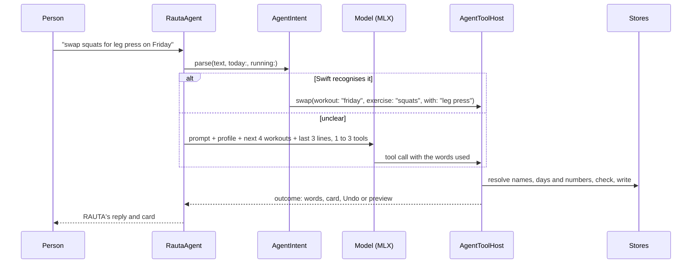

# Architecture

How RAUTA is put together: the targets, where state lives, how a workout moves between the phone, the watch and
the Lock Screen, and how a request to RAUTA becomes a change. The [README](../README.md) covers the planner and
the reasons behind the main decisions.

1. [Targets](#1-targets)
2. [Layers](#2-layers)
3. [Persistence](#3-persistence)
4. [A workout from start to finish](#4-a-workout-from-start-to-finish)
5. [Phone, watch and Lock Screen](#5-phone-watch-and-lock-screen)
6. [The agent](#6-the-agent)
7. [Backups and iCloud](#7-backups-and-icloud)
8. [Health and sound](#8-health-and-sound)

## 1. Targets

| Target | Role |
| --- | --- |
| `Rauta` | The iPhone app: engine, stores, agent, screens and system integrations. |
| `RautaWatch` | Follows the phone's workout in its own HealthKit session; logs sets and rests. Embedded in the iPhone app. |
| `RautaWidgets` | The Live Activity on the Lock Screen and in the Dynamic Island. |
| `RautaTests` | Swift Testing suites, run on a simulator. |

`Shared/` is compiled into the app and the widget extension: the activity attributes and the palette the Lock
Screen card draws with. `WatchShared/` is compiled into the app and the watch: the payload sent between them and
the sync rules, written as pure functions so both sides are tested against the same code. `Common/` holds the
brand constants and the elapsed-time clock.

## 2. Layers

```mermaid
flowchart TB
    V[Views<br/>SwiftUI] --> S[Stores<br/>@Observable, main actor]
    A[Agent<br/>AgentIntent, tool host, model] --> S
    S --> E[Engine<br/>Training/, nonisolated]
    S --> P[Persistence<br/>snapshots, drafts, intents]
    S --> N[Native services<br/>Health, watch, Live Activity,<br/>Calendar, voice, sound, backups]
```

| Layer | Folder | What it is |
| --- | --- | --- |
| Engine | `Rauta/Training/`, about 5,400 lines | Value types and static functions with no UI, persistence or shared state. It takes a `ProgramGenerationRequest` and returns `success`, `partial` (with the targets it couldn't meet), `invalid` or `unsupported`. |
| Stores | `Rauta/Stores/` | The app's state, on the main actor. Pages read it through Observation. |
| Agent | `Rauta/Agent/`, about 4,500 lines | Reaches the stores only through `AgentToolHost`, the same checked paths the screens use. See [section 6](#6-the-agent). |
| Native services | `Rauta/Native/` | Started once at launch. Each follows store changes out to the Live Activity, rest alerts, reminders, Calendar, Spotlight, Health, the watch or iCloud. |

The engine was ported from a TypeScript engine. Its policy's weight tables are still keyed by string, so a saved
snapshot is byte-identical to one the TypeScript engine wrote.

## 3. Persistence

Every store saves a `{ state, version }` JSON envelope, the shape the earlier web app kept in `localStorage`, so a
backup from either restores on the other. Small state goes to user defaults. The training history grows with
every set, so it gets a file of its own.

The structured training records are three kinds of document:

| Record | What it holds |
| --- | --- |
| Program snapshot | The plan exactly as generated: engine version, the policy as opaque JSON, a fingerprint of the exercise dataset, the weeks, diagnostics and any adaptation. A restore never substitutes today's default policy. |
| Program revision | A change to a plan: the remaining week, the next week, or a manual rebuild. It lists the sessions it consumed and the prescriptions it replaced. Past sessions stay in the source program. |
| Workout draft | A workout in progress: its exercises, prescriptions and the sets actually logged (observations). |

A draft made from a planned session keeps a link from each set to the prescription it answers (`plannedSetId`).
That link, not the exercise, decides what counts: a substituted exercise still answers the set it replaced, and
an extra set the person added is real work but never stands in for a prescribed set nobody did. If the plan is
replaced while a session is still to be trained, the draft is cut loose from it, so the session isn't counted
against a plan that no longer runs.

## 4. A workout from start to finish

Starting, finishing and cancelling are one action to the person and several writes to separate stores
underneath. Each begins by writing an intent that names the transition, the identities it will use and, for a finish, the
single instant it completes at. On launch, `Transition` reads any intent left behind and decides:

| Found at launch | Result |
| --- | --- |
| A start that never created its draft | Nothing to carry forward. |
| A start whose draft exists but whose workout never appeared | The start is completed. |
| A start already complete in both stores | Nothing more to do. |
| A finish with steps still owed | The remaining steps run, with the recorded instant. |
| A finish already in history | Nothing more to do. |
| A cancel with its draft still open | The cancel is completed. |
| An intent naming a different draft | Not applied. |

Replaying an intent any number of times reaches the same state as running it once. An intent is never evidence
of work: which sets were performed lives only in the draft's observations.

On finish, the draft's observations become history. Planned targets that were never performed drop out of the
history but stay in the program snapshot, which is never modified.

## 5. Phone, watch and Lock Screen

### The phone owns the workout

It sends the watch an envelope with the current state, both as the application
context (the latest state, delivered whenever the watch next runs) and, while the watch is reachable, as a
message. Envelopes carry a revision that always increases and is tied to the clock, so:

- one that arrives late, out of order with another, is ignored instead of putting a finished set back;
- a reinstalled phone app never starts below a revision the watch has already seen.

### The watch can work alone

Sets logged on the watch out of the phone's reach are kept as pending and laid over
the phone's last envelope, so the watch moves on to the next set at once. When the phone answers, a pending set
logged within half a rest of one the phone already has is treated as the same set; anything further apart was a
set the watch was behind on, and goes on the next one. The watch runs its own HealthKit workout session, so it
keeps the workout when the app is in the background, and the system relaunches it into a workout still running
after a crash.

### The phone stays awake

An iPhone HealthKit workout session (iOS 26 and later) keeps the app from being
suspended during a workout, the way a navigation app keeps running. That is what lets a rest end with a sound on a
locked phone instead of a notification. The session collects nothing.

### The Live Activity counts by itself

It is given the wall-clock instant the stopwatch effectively started, and
ActivityKit counts from there, so a running workout needs no per-second updates. A paused workout carries its
frozen elapsed time instead. Every field is a pure function of the session, so updates that wouldn't change a
pixel are skipped. On relaunch into a running workout the existing card is adopted, not duplicated, and any
ActivityKit failure is swallowed: the card is an accessory to the workout, never a reason to break it.

### RAUTA without Rive

Rive has no watchOS runtime and WidgetKit can't draw its Metal view. The watch plays
sprite sheets of the real rig, one per mood. The Lock Screen uses fonts whose glyphs are animation frames: stacked
`Text(date, style: .timer)` views in those fonts play the loop with no updates from the app. Both are rendered from
`rauta.riv` by `scripts/rauta-frames/build.py`.

## 6. The agent



- Tools take the person's words ("friday", "bench", "2 left"). The host resolves them
  against the current stores (a weekday to a date in that workout's week, a name to an exercise in that workout)
  and refuses with a reason when nothing matches. A number the person didn't say falls back to the profile.
- A tool returns by ending the turn with a checked result. RAUTA's words come from
  that result; the model never writes a confirmation of its own.
- Swaps, moves and added or removed exercises apply immediately, with an Undo that
  restores a snapshot taken just before. A new plan, an adjusted week, a new workout, finishing, discarding or
  deleting a workout, and Calendar events come back as a preview card; nothing is saved until Apply. After a
  relaunch, pending previews expire and old Undo buttons are disabled.
- A free-form answer has markdown, reasoning and tool syntax stripped, and replies about
  tools, access or being an AI are dropped. Raw errors are never shown: after a model failure a looser Swift
  reading runs, and failing that RAUTA asks a question back.
- The model is downloaded on request into Application Support in the Hugging Face cache layout, pinned to
  a commit, excluded from device backup. Anything no longer in the catalogue is deleted. One real tool prompt runs
  right after the download so the first question doesn't pay for GPU warm-up. Generation stops whenever the app
  leaves the active state; a memory warning evicts the model.
- On a phone with less than 6 GB of memory, or before the download, everything
  `AgentIntent` recognises still works; other questions get an explanation of what does, and how to set up the
  model.

## 7. Backups and iCloud

- Full backups are files in `Documents/Backups`, visible in the Files app, kept on a rolling basis. Each has a
  checksum manifest and is validated before import.
- A restore takes a safety copy first, so it can be undone. An interrupted restore (the app went away between
  replacing the first store and the last) is detected on the next launch and can be finished from the same file
  or rolled back to the safety copy.
- Merging keeps tombstones for deleted workouts, so a copy from another device doesn't bring them back.
  A copy that arrives during a workout is held until the workout ends, so nothing changes under a set being
  logged.
- iCloud key-value storage keeps a compact copy: preferences, profile, favourites, equipment and the workout
  list. It survives reinstalling and follows the iCloud account, but its whole allowance is 1 MB, so the
  structured training records are not in it.
- "Clear all data" deletes the backups too.

## 8. Health and sound

### Health

RAUTA writes finished workouts with their active energy and reads body weight for calorie estimates
and load reasoning. A workout the watch recorded is the watch's to save; both devices tag the Health workout with
the same external UUID, so each can find the other's and nothing is saved twice. Sleep, heart-rate variability
and resting heart rate feed an optional readiness signal. Missing data stays missing, and RAUTA never turns it
into a medical conclusion.

### Sound

`SoundArbiter` sets the audio session for what is playing, and a higher style holds until released:

| Style | Used for | Behaviour |
| --- | --- | --- |
| `ambient` | Taps and RAUTA's phrases | Mixed in, silenced by the ring switch; music is untouched |
| `mixed` | A set logged, a rest starting | Heard with the ring switch on and on a locked phone, over the music |
| `ducking` | The countdown and the end of a rest | The music dips while they play |

The bundled sounds are rendered by `scripts/sounds/generate.py`. Sounds made on the spot, such as RAUTA's voice
and a card arriving, are synthesised by `SoundSynth` with the same recipe. No haptic pattern plays exactly the
same way twice.
