**RAUTA — product exploration and subscription plan**

6 October 2026 · Analysis only · Audience: beginners and regular gym users

Follow-up: [Hosted AI costs and subscription plan](HOSTED_AI_COST_AND_SUBSCRIPTION_PLAN.md) covers optional cloud models, usage allowances, spending controls and the server scope they introduce.

**Recommendation**

Keep RAUTA Free a useful, trustworthy workout companion. Sell RAUTA Plus as ongoing guidance: a plan that develops with the user's training, adjustments when their week changes, and a clear explanation of their progress.

The promise to test is: **“Know what to train next, how to progress, and what to change when life gets in the way.”**

RAUTA already has much of the underlying machinery. The largest opportunity is making that machinery easy to understand and reliable enough to pay for. Start with one paid tier, offered monthly and annually. Pricing and willingness to pay remain hypotheses; this exploration does not establish demand.

**What I examined and what is verified**

I explored the existing installed app on the “Rauta Tests” iOS simulator, captured and inspected 14 screenshots, reviewed the current Swift source and exercise metadata, and researched official competitor and Apple sources. The simulator already contained demonstration history and a running “Demo” workout. I generated one three-session plan and asked the assistant to show the schedule. No application code, dependencies, or project configuration were changed. The new files are this report and its screenshots; the existing Xcode project edit was left untouched. Exploration added a plan and a schedule conversation to the test simulator.

The installed simulator build was not rebuilt from the current checkout. Screen findings describe that installed build; source findings describe the current checkout. The two equipment examples below were observed in the app and independently confirmed in the current bundled metadata.

| Capability | Current evidence | Implication |
|---|---|---|
| Native iPhone app, offline operation, no RAUTA account/backend | README and app architecture | Preserve the low-friction, private experience. |
| 1,324 exercises, muscle/equipment filters, favorites, demonstrations and instructions | Screenshots 3–4 and bundled catalogue | Strong foundation; beginners need a smaller recommended selection. |
| Manual workouts, scheduling, reuse, sets, loads, reps, effort and timers | Workout source and screenshots 2, 11, 14 | Enough core value for a useful free product. |
| Personalized plans, extension, remaining-week adjustment, substitutions | Planning source; generation observed in screenshots 9–11 | Strongest candidate for a paid recurring benefit, after quality improvements. |
| History-based progression and explanation notes | Progression engine, `ProgressionNotes`, screenshot 14 | Build on existing guidance instead of presenting this as entirely new. |
| Activity, training time, streaks, muscle volume and personal records | Summary source and screenshot 1 | Existing descriptive statistics should remain useful in Free. |
| Assistant with structured actions and typed/voice entry | Agent source and successful schedule request, screenshots 6–7 | A convenient interface to capabilities; “AI chat” alone is a weak paid product. |
| Apple Health, readiness signals, Watch companion and Live Activities | Native/shared/watch source; Health settings visible | Integration foundations exist; real-device reliability was not verified here. |
| Export/import and compact iCloud backup | Backup source and settings | Manual export includes detailed training; automatic iCloud backup does not. |
| Subscription infrastructure | No StoreKit, RevenueCat or paywall implementation found in app/watch source | Billing and entitlement behavior would be new work. |

Dates spanning multiple weeks can already be grouped into weekly generation requests. That is different from a deliberate training block with an objective, milestones, evaluation and progression across the block. A polished six-week program would require additional product and planning work. [Current planning flow](../../ios/Rauta/Rauta/Lib/TrainingPlan.swift#L326).

**Fix these before monetizing planning**

1. **Make equipment recommendations trustworthy.** With a Beginner / General fitness / No equipment profile, the generated plan included Monster Walk and Gironda Sternum Chin. Monster Walk's instructions require a resistance band; Gironda's require a high bar. Both catalogue entries and curated `requiredEquipment` list only body weight. This is an observed contradiction, not a hypothetical concern. Review required equipment separately from the resistance being lifted, and review beginner difficulty and practical substitutes. Check these combinations before selling “plans matched to your equipment.” Evidence: screenshots 1, 10–11, 13 and exercise IDs `0628`, `0466` in the [catalogue](../../ios/Rauta/Rauta/Resources/exercises.generated.json) and [curated metadata](../../ios/Rauta/Rauta/Resources/exercise-metadata.curated.complete.json).

2. **Protect the history that drives progress.** `AppBackup.createBackup` defaults `includeLocalTraining` to false; iCloud uses that default, while manual export explicitly includes training. The automatic backup therefore omits structured sessions/programs/settings that underpin progression and records. Its current payload limit is 900,000 bytes. Define a complete backup/restore strategy and clear status before promising durable progress or cross-device coaching. The privacy copy currently describes a backup of “training data,” which needs to match the actual scope. This was established from source; I did not erase a device or run a destructive restore. [Backup scope](../../ios/Rauta/Rauta/Native/AppBackup.swift#L12), [iCloud upload](../../ios/Rauta/Rauta/Native/ICloudSync.swift#L112), [privacy wording](../../ios/Rauta/Rauta/Views/Screens/PoliciesScreen.swift#L266).

3. **Make the next action visible.** Summary starts with identity and historical totals. Add a prominent “Today / Next workout” card with Start, Resume, or Build a starter plan. Keep existing history below it. Planning is available in RAUTA's Summary menu, while the Library menu presents different actions. Give the primary planning action a stable, labeled entry point. Evidence: screenshots 1, 5, 8.

4. **Help the user start this week.** On Tuesday 6 October, the defaults selected Monday 12, Wednesday 14 and Friday 16 October. A new user could wait six days before their first planned session. Offer “Start today” and “Start next week,” with visible dates. This is a default improvement; the existing calendar already permits date changes. [Default selection](../../ios/Rauta/Rauta/Views/Screens/PlanWeekScreen.swift#L243), screenshot 9.

5. **Translate training language for beginners.** RIR, calibration, effective sets and estimated 1RM need short explanations at the point of use. For example: “Reps left: how many more repetitions could you have done?” Preserve unknown effort as unknown; do not silently assume a number and treat it as a reliable observation. Use “try this load and tell RAUTA how it felt” when history is insufficient. Screenshots 11, 14 and progression source support this need.

6. **Explain plan choices and time estimates.** The app promised to fit about 60 minutes per session, then produced estimates of 38, 28 and 26 minutes. Shorter sessions are not inherently wrong, but explain whether the preference is a maximum and why the session is shorter. Add a brief “Why this workout?” summary, required kit, and an easy replacement action. Evidence: screenshots 9–11.

7. **Make assistance and downloads understandable.** Settings exposes the model name Qwen3.5 2B. The physical-device model is approximately 1.749 GB; the simulator uses Apple's system model and cannot validate the physical-device download or inference experience. Present the benefit, size, progress and recovery first: “Enable private conversations on this iPhone.” Keep standard actions usable while the model is unavailable; the deterministic intent path already supports this direction. [Model size](../../ios/Rauta/Rauta/Agent/Models/RautaModelCatalog.swift#L36), [runtime paths](../../ios/Rauta/Rauta/Agent/Core/RautaAgent.swift#L101).

8. **Strengthen readable, inclusive feedback.** The visual style and character are memorable. Small muted labels, color-based muscle intensity, truncated guidance and dense set tables may be difficult under gym lighting or with larger text. Test VoiceOver, Dynamic Type, contrast and Reduce Motion on devices. A zero-day streak should not dominate the experience of someone training three days a week; add “2 of 3 planned sessions this week” and recognize planned rest days. These are visible risks and product recommendations, not a claim of accessibility failure or compliance.

Onboarding has eight steps in source. I did not reset the simulator to audit it. A future test should examine a shorter path from goal, experience, available kit and session length to a first workout, with optional profile detail later.

**Recommended free and paid boundary**

| Experience | RAUTA Free | RAUTA Plus |
|---|---|---|
| Workout logging | Unlimited manual sessions, editing, scheduling and reuse | Same foundation |
| Exercise library and instructions | Full library, demonstrations, filters and favorites | Personalized recommendations within the library |
| Personal history | All saved workouts, set history, previous performance and basic personal bests | Trends with explanations and suggested next steps |
| Basic summaries | Activity, training time, consistency and current descriptive muscle map | Weekly review, planned versus completed volume, progress interpretation |
| Getting a plan | One personalized starter week; retain and reuse it manually | Ongoing generation, extension and adjustment using accumulated history |
| Progression | Previous loads/reps and retained prescriptions | Continued targets for the next sessions, with reasons and uncertainty |
| Changes during training | Manual swaps, rescheduling and basic assistant commands | Rebalance remaining training, shorten a session, or tailor replacements to the goal and constraints |
| Health, Watch and Live Activities | Keep the core integration and logging experience | More interpretation/adaptation when reliable data is available |
| Ownership and access | Offline logging, export/import, reliable backup, accessibility options | Same protections |
| Personality | Existing RAUTA character and interactions | Optional new cosmetic extras later |

This boundary is a product hypothesis, not an implemented entitlement specification. The free starter week is a sample without automatic billing; distinguish it clearly from an App Store subscription trial. On expiration, retain saved plans and allow manual use/editing. Stop newly generated coaching and future reviews. Never lock a current session, user-created workout, personal history, export, or essential exercise instruction.

If there are existing users who already have free planning/progression, decide a grandfathering or transition offer before gating those features. Keep the baseline they relied on and sell expanded coaching where practical. Distribution status and the size of that audience were not established here.

**The smallest paid product worth validating**

Bundle three connected benefits:

- **My next week:** use training history, goal, available days, kit and session length to produce the next plan. Show what changed and why; preserve useful exercise continuity rather than creating unnecessary novelty.
- **Help me adjust:** an explicit, reviewable proposal after a missed session, a shorter available slot, or unavailable equipment. Preview the affected workouts before applying it. Existing planning/substitution/proposal machinery provides a starting point; not every proposed scenario is already supported.
- **My weekly review:** summarize consistency, meaningful changes in comparable exercise performance, and one useful action for the next week. Label sparse or missing data. This surfaced review is new product work built on existing analysis.

An illustrative review could say: “You completed 2 of 3 sessions. Your bench sets reached the top of the target range. Here is the proposed adjustment for next week.” Only populate such statements from recorded evidence; the example is not a finding about an actual user.

Treat the assistant as an optional way to access these features. Give each benefit a visible button/card too. Do not make users discover prompts or depend on a model download to obtain the subscription's central value. Do not market it as a human trainer or rehabilitation service; respect the current planner's eligibility limits.

**Other additions, in priority order**

| Idea | Why a user might value it | Monetization fit | Relative effort / readiness |
|---|---|---|---|
| Weekly review with an explicit next action | Makes progress understandable and gives a reason to return | Strong Plus benefit | Medium; analysis exists, presentation is new |
| Missed-session and time-constrained adjustment | Helps users continue a realistic week | Strong Plus benefit | Medium; existing adaptation needs scenario validation |
| Named goals and progress checkpoints | Gives beginners a direction beyond generic logging | Plus after the first bundle | Medium; some profile/goal foundations exist |
| Gym/home/travel kit presets with load steps | Reduces repeated setup and helps realistic progression | Basic presets Free; advanced automatic use can support Plus | Foundations exist; kit quality needs review |
| Deliberate six-week training blocks | Connects individual weeks to a longer objective | Strong later Plus addition | High; distinguish it from current date-based weekly generation |
| Readiness-aware adjustments | Helps choose an appropriate plan when useful signals exist | Secondary Plus benefit | Foundations exist; device/data validation needed; optional |
| Custom exercises and easier import from other logs | Removes switching and catalogue gaps | Free foundation or supporting paid flexibility | New work; inspect representative files first |
| Better routine organization and shortcuts | Speeds up repeated use | Retention feature; weak main subscription reason | Low–medium |
| Extra RAUTA appearances, seasonal reactions, supporter pack | Lets fans personalize and support development | Optional one-time purchase | Lower priority; do not remove the existing character |
| Coach sharing, family collaboration, social feed | Serves a broader audience | Potential separate business later | High; introduces account/backend/support work |
| Nutrition, camera form analysis, broad open-ended health advice | Extends far beyond today's core workflow | Do not include in the initial subscription | High uncertainty and scope |

**What the market comparison changes**

Hevy's official Trainer page currently lists adaptive programming as part of Pro at **$2.99/month, $23.99/year or $74.99 lifetime**. Its free tier includes four routines; Pro also offers additional tracking and programming. This is a substantial low-price competitor, so ordinary progression or “AI plans” alone do not justify a much higher RAUTA price. [Hevy Trainer](https://www.hevyapp.com/features/workout-plan-generator/), [official tier comparison](https://help.hevyapp.com/hc/en-us/articles/35119778922263-Hevy-Pro-Subscription-How-to-get-Pro-and-What-Does-It-Include).

Strong allows three free workout templates and sells unlimited templates, charts, measurements and calculators through Pro. Its help center explicitly says users retain access to their workout data. It illustrates a logger-plus-tools business model, but imposing template limits is not my preferred initial RAUTA strategy. [Free templates](https://help.strongapp.io/article/105-about-templates), [Strong Pro](https://help.strongapp.io/article/132-strong-pro).

Fitbod's current website lists **$15.99/month or $95.99/year** for personalized adaptive workouts. This illustrates a higher-priced planning product; it is not evidence that RAUTA users will pay the same amount. [Fitbod membership](https://app.fitbod.me/).

These are published US-dollar examples checked on 6 October 2026, not French App Store price quotes. Local pricing, promotions and platform offers can differ. RAUTA's private on-device approach and approachable character are promising reasons to choose it; offline functionality itself is not unique to RAUTA.

**Pricing to test**

Use **€4.99/month and €34.99/year** as an initial European pricing hypothesis for the complete weekly bundle. Annual works out to about €2.92/month and is about 42% below twelve monthly payments; show the full annual bill prominently. This sits above Hevy's published dollar price and below Fitbod's, without treating currencies as directly equivalent. The experience must earn that difference.

Validate a €2.99–€5.99 monthly range through concrete product choices. If users only value extra charts or appearance, reconsider a one-time purchase instead of forcing a subscription. Do not add three paid levels, a weekly billing option, or a cheap lifetime coaching offer at launch. Monthly and annual should unlock the same capabilities.

An eligible seven-day App Store trial is a reasonable first experiment once the product is ready. It should expose a real plan and useful adjustments; compare it with a straightforward free starter week. A short trial may not expose enough training history for a convincing review, so measure that limitation. Clearly disclose the trial duration and subsequent charge. Apple describes subscriptions as providing ongoing value and recommends clear subscription management. [Apple subscription guidance](https://developer.apple.com/app-store/subscriptions/).

**Where an upgrade belongs**

- After the starter week, when the user asks to build the next week: show a specific preview of what Plus would change using their history.
- When the user explicitly asks for an adaptive adjustment: explain the benefit, price and Free alternative before purchase.
- From a weekly-review teaser: describe the actual analysis available; do not fabricate an insight to sell access.
- In a clearly labeled RAUTA Plus row in Settings, with subscription status, restore and manage actions.

Avoid interrupting onboarding, an active set, rest timing or workout completion with a purchase screen. A completed first workout is a better moment to establish trust and invite exploration than to block progress. Keep a clear dismiss action and consistent treatment of free, trial, paid and expired states.

**Validation before implementation**

1. **Talk to 8–12 people split between beginners and regular gym users.** Have them show how they currently decide the next workout and load. Ask about a recent missed session and what they changed. Prefer concrete behavior over “would you use AI?” answers. Recruit users of competing apps as well as people with no tracker.
2. **Test the current first-workout path.** Observe whether they find planning, understand the equipment and targets, and can complete a set without help. Watch the default start date, exercise familiarity and RIR terminology.
3. **Show three concrete paid examples.** A next-week plan with explained changes, a missed-session adjustment, and a weekly review using clearly labeled sample data. This can initially be a document or prototype; no billing integration is needed to learn which outcome matters.
4. **Run a small four-week pilot after the trust gaps are fixed.** Observe repeated use of planning and adjustment, not just one-time curiosity. Check whether participants can explain why they would continue paying. Ask them to choose between Free, the proposed bundle, and a competitor at explicit prices.
5. **Make the launch decision from repeated value and actual purchase behavior.** A handful of enthusiastic interviews is directional evidence, not a conversion forecast. A later limited paid launch is needed to validate willingness to pay.

Track activation (first workout completed), second-workout return, planning/adaptation reuse, third/fourth-week retention, trial-to-paid conversion, renewal, cancellations and refunds. Define each denominator before comparing cohorts. Also track plan refusals, equipment mismatches, correction requests and data-recovery failures. There are no current usage/retention numbers in this exploration, so none are presented as benchmarks or forecasts. For research, use consented participant logs and App Store reporting where available; production telemetry would be a separate privacy decision.

**Implementation sequence to use later**

| Phase | Deliverable | Completion condition |
|---|---|---|
| 1. Trust and activation | Equipment/difficulty review, complete backup strategy, clear next action, beginner explanations, start-date choice | Representative beginner/kit combinations produce usable plans; complete data can be restored; first workout is discoverable |
| 2. Coaching value | Next-week changes, reviewable adjustments, weekly review | Users understand the recommendations and repeatedly return during the pilot |
| 3. Subscription plumbing | One entitlement, monthly/annual products, purchase/restore/manage flows | Purchase states work and expiry never blocks logging or retained data |
| 4. Limited launch | A small paid rollout with clear offer and existing-user transition | Evidence of repeated coaching use, purchases and renewals; product-quality issues remain visible |
| 5. Expand selectively | Goal blocks, deeper analysis or readiness features | Add only what users request/use and what can be validated reliably |

For today's Apple-only architecture, begin the technical design with native StoreKit and local verified entitlements. Apple supports using StoreKit verification rather than requiring your own purchase-validation server. A RAUTA backend is therefore not a prerequisite for a first implementation of locally delivered premium features. RevenueCat is an optional later choice for centralized entitlement operations and future platforms. [Apple In-App Purchase documentation](https://developer.apple.com/documentation/storekit/in-app-purchase?changes=_9).

Entitlements must be enforced in planning/review operations as well as UI entry points, including assistant and App Intent routes. Plan for verified purchases, restore, transaction updates, pending/canceled purchase, expiry, billing grace, refund/revocation and offline access. Do not equate “cancel auto-renew” with immediate expiry, or an unverified purchase with paid access. Validate these with StoreKit testing and sandbox before release. [Current entitlements](https://developer.apple.com/documentation/storekit/transaction/currententitlements?changes=_7), [StoreKit testing](https://developer.apple.com/documentation/storekit/testing-in-app-purchases-in-xcode).

Workouts should continue offline; buying, restoring and learning about a new renewal may require connectivity. Decide and test offline expiry behavior explicitly. The product promise should describe private training data accurately while acknowledging App Store billing. The detailed technical design is future work, not something implemented in this report.

**Captured exploration, in order**

Screenshots below are the exact accepted captures from this run. They are intentionally small simulator captures, sufficient for the observed hierarchy and copy; they are not a pixel-level contrast or layout measurement.

**1. Summary — functional; next-action gap.** Clear brand and useful totals. The visible emphasis is past activity rather than the next workout. The pre-existing Demo session creates a persistent bottom accessory; do not interpret its multi-hour timer as a real user's workout. Small muted metadata needs device testing.

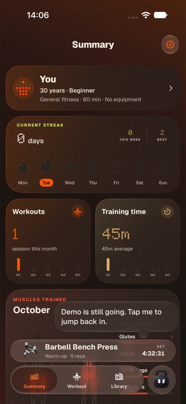

**2. Workouts — clear history; creation needs discovery.** Date grouping, completion status and muscle hints make history scannable. Filters are clear. At this state, creating or planning a workout is not an obvious in-page action. The active accessory takes space near the bottom.

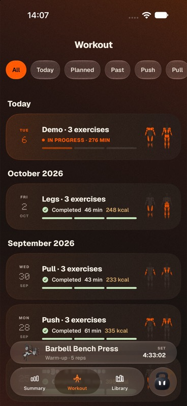

**3. Library — strong catalogue; broad for a beginner.** Demonstrations, filters and search are useful. A 1,324-item alphabetic starting point gives little guidance on what to choose first. Add a small recommended/foundational selection without reducing access to the full library.

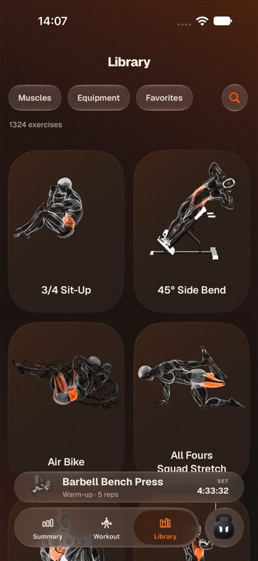

**4. Exercise detail — useful instructions; readability needs testing.** Demonstration and numbered instructions explain the exercise; Add to workout is prominent. Instruction text extends below the first viewport. Check that larger text and scrolling keep the final instructions reachable above the fixed action.

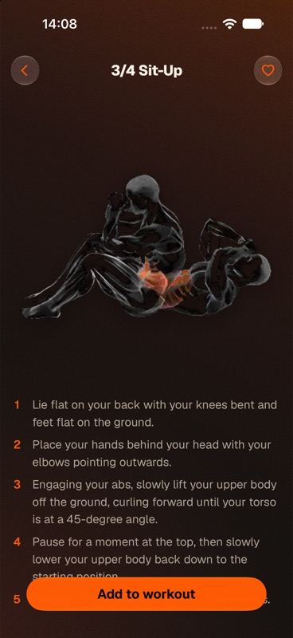

**5. Library RAUTA menu — functional; capability discovery gap.** The menu offers Ask me anything and Choose exercises. It does not expose planning in this context. Preserve contextual shortcuts, but give the core plan a stable entry elsewhere.

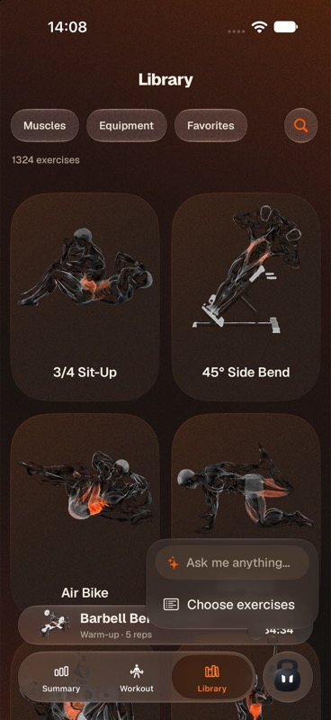

**6. Assistant entry — approachable; constrained capability should be clearer.** The empty state explains moving, swapping and rebuilding and offers contextual requests. The broad “Ask me anything” label could overstate the supported experience. Closing via a menu under RAUTA's name is less discoverable than a labeled close action.

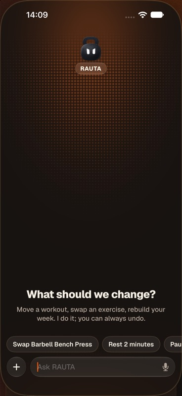

**7. Assistant schedule response — functional.** “Show my schedule” returned the existing Demo workout in a structured card. This verifies one deterministic read-only command, not arbitrary model reasoning, voice recognition or coaching quality. Structured cards are a good foundation for reviewable changes.

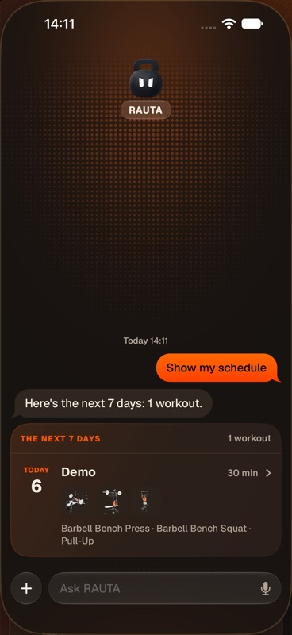

**8. Summary RAUTA menu — useful actions; hidden primary entry.** Create training plan is available alongside Continue workout and Choose exercises. The label is clear once found. Surface it on Summary rather than relying entirely on the character menu.

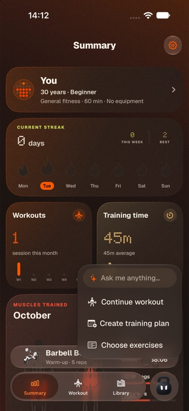

**9. Plan date selection — simple interaction; late default start.** One calendar and one action keep the task focused. Defaults begin next Monday rather than this Tuesday. Add a start-date choice and make the 60-minute preference's meaning clear.

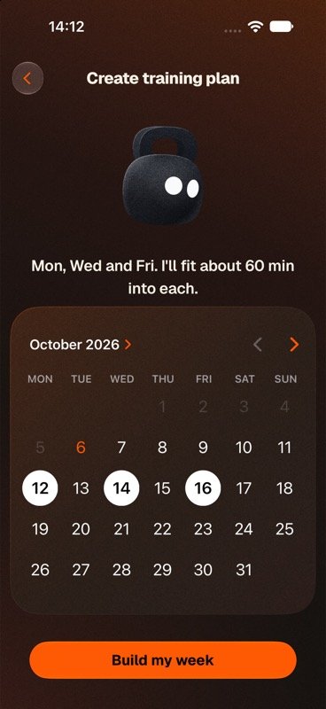

**10. Generated plan — generation works; recommendation trust issue.** Three full-body sessions were produced and saved. The output includes Monster Walk and Gironda Sternum Chin despite No equipment; estimates are 38/28/26 minutes after the earlier 60-minute statement. Explain choices and review metadata before selling this outcome.

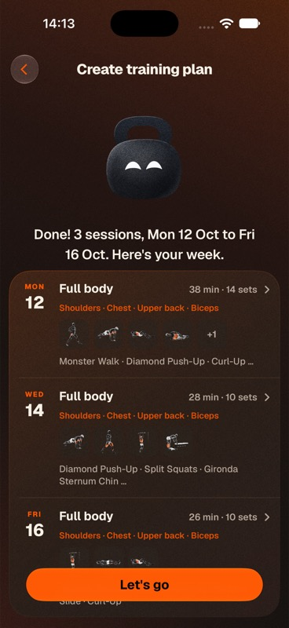

**11. Planned workout — clear prescriptions; jargon and kit mismatch.** Sets, reps, RIR and rest are visible. Monster Walk is labeled Body Weight although its own instructions require a band. Beginners need effort guidance and equipment requirements, not just numbers.

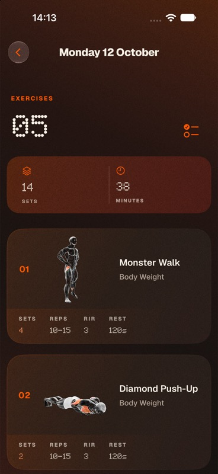

**12. Settings — broad controls; model presentation is technical.** Profile, preferences and Health controls are grouped. Model naming exposes implementation details where benefit and setup guidance would help. Automatic backup scope was reviewed in source; it is not established by this screenshot.

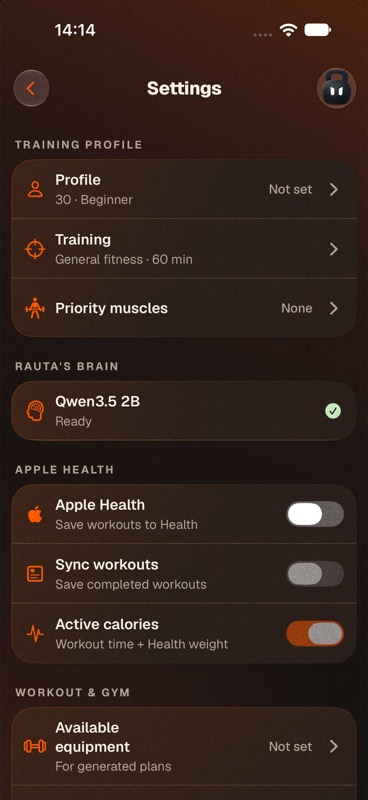

**13. Equipment selection — understandable groups; planning needs finer requirements.** Cards and Home kit / Full gym shortcuts make selection approachable. The selector should distinguish required fixtures for bodyweight exercises; band/bar dependencies cannot be inferred just from resistance type. No equipment selections were deliberately changed.

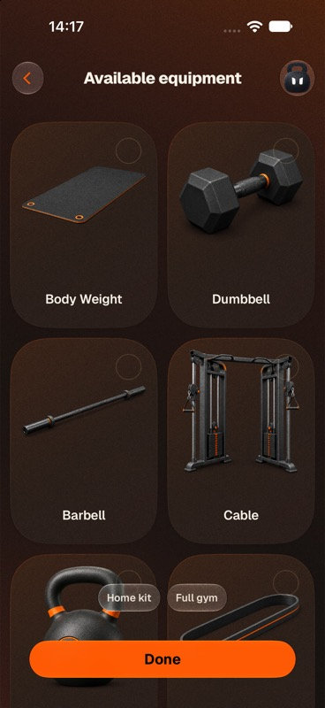

**14. Set logging — useful foundation; dense guidance.** Large load/repetition controls and explicit warm-up logging support the task. RIR is compact and progression guidance is truncated. This screen demonstrates that progression guidance already exists; improve its explanation and accessibility. I did not log a set or complete/discard the existing Demo workout.

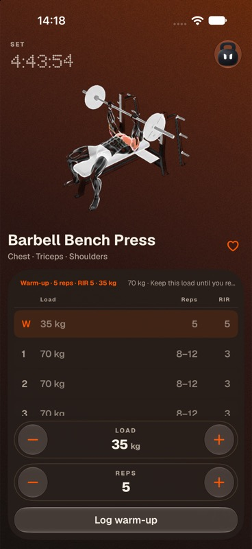

**Evidence limits**

This is a product exploration and subscription hypothesis, not a comprehensive QA or fitness-program validation. I did not test real iPhone inference/download behavior, VoiceOver, large text, measured contrast, Watch connectivity, Health permissions/data, notification delivery, full workout completion, billing, or a destructive backup restore. The simulator uses a different model path from the physical app. No production analytics, user interviews or purchase experiments were supplied. Recommendations about motivation, demand and pricing require validation; source-supported bugs and visible workflow findings are identified separately above.
