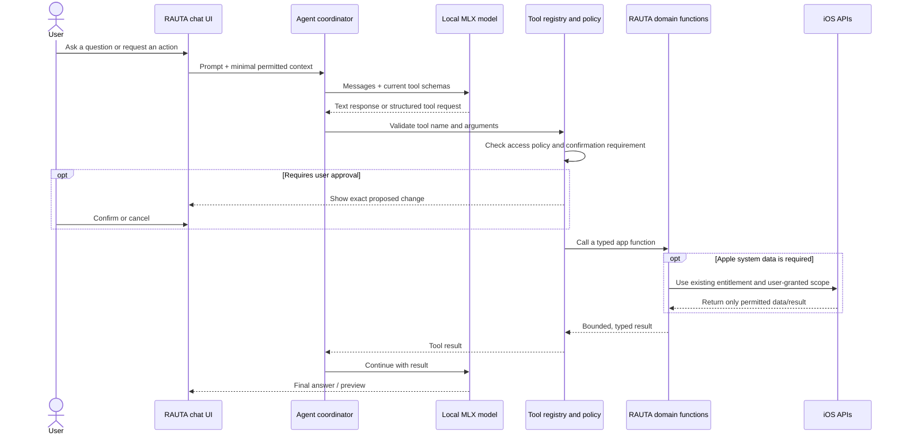

# On-Device Agentic Workflows for RAUTA on iOS

**Research snapshot:** September 25, 2026  
**Purpose:** explain how a local model can act as an agent through app-defined tools, what RAUTA could safely expose, and what iOS does and does not let the app access. This is research and architecture guidance only; no application source was changed.

Related research: [Locally AI on iOS: reproduction blueprint](./locally-ai-ios-reproduction.md).

## Executive summary

A local model is the agent’s language and reasoning engine; it is not the agent’s permissions or execution environment. The app supplies a small, typed set of tools. The model can request a tool call; RAUTA validates the call, applies its own permission and confirmation policy, invokes an existing domain function or a user-authorized Apple API, then returns a limited result to the model. The model never receives arbitrary access to app files, HealthKit, other apps, or the operating system.

This architecture fits RAUTA particularly well because the app already has structured training profile, equipment, exercise catalogue, workout history and deterministic planning logic. It can give a local model useful context and actions without adding a backend. RAUTA’s current HealthKit use is narrow: it reads body mass and writes completed workouts/optional active energy under the app’s existing Health permission flow; it does not currently expose broad Apple Health data to an agent. ([RAUTA `HealthService.swift`](../../ios/Rauta/Rauta/Native/HealthService.swift))

At the current iOS 27 target, there are two plausible tool-calling routes: `mlx-swift-lm` has typed tools and model-specific tool-call parsing; Apple’s Foundation Models framework has a typed `Tool` protocol, and the current MLX Swift LM repository also offers an adapter that lets an MLX model use Foundation Models’ `LanguageModelSession` interface. The latter requires the iOS 27 SDK per that repository. Neither path removes the need for app-side validation and consent. ([MLX Swift LM tool-calling guide](https://github.com/ml-explore/mlx-swift-lm/blob/main/skills/mlx-swift-lm/references/tool-calling.md), [Apple Foundation Models `Tool`](https://developer.apple.com/documentation/foundationmodels/tool), [MLX Foundation Models adapter](https://github.com/ml-explore/mlx-swift-lm/tree/main/Libraries/MLXFoundationModels))

## 1. The agent loop



The important boundary is **model intent versus app authority**. Tool calling is a structured request, not a security decision. The app owns the tool registry, validates every argument, decides whether the action is read-only or mutating, checks iOS permissions where relevant, and shows confirmation before committing consequential changes.

### Available local tool-calling mechanisms

| Route | What it provides | Considerations for RAUTA |
|---|---|---|
| **MLX Swift LM tools** | Typed `Tool<Input, Output>` definitions, tool schemas, streaming `.toolCall` events, parser/format handling, and optional schema validation. | This directly fits an MLX model. Tool-call syntax varies by model; the project documents formats for model families and explicitly says not to assume format from family alone. Pin a package revision and qualify every model in RAUTA’s catalog with tool-call cases. ([Guide](https://github.com/ml-explore/mlx-swift-lm/blob/main/skills/mlx-swift-lm/references/tool-calling.md)) |
| **Apple Foundation Models tools** | A Swift `Tool` protocol whose typed arguments and return value are presented to `LanguageModelSession`; tools can gather app data or perform side effects. | Nice typed Swift interface, but availability follows Apple’s Foundation Models platform support. The API will call the handler; RAUTA must put consent/validation inside the handler or before execution. ([Apple API](https://developer.apple.com/documentation/foundationmodels/tool)) |
| **MLX through the Foundation Models interface** | `MLXFoundationModels` adapts an MLX model to `FoundationModels.LanguageModel`, allowing Foundation Models session patterns, including tool calling and streaming, with MLX inference. | Current upstream says this requires the iOS 27 SDK. It is a promising fit for RAUTA’s current target, but is a recent integration: verify the exact pinned release, model support, and tool behavior on hardware before adopting it. It is not evidence that Locally AI uses this design. ([Upstream adapter](https://github.com/ml-explore/mlx-swift-lm/tree/main/Libraries/MLXFoundationModels)) |

For direct MLX tool calls, the library’s documentation describes multiple wire formats (`.json`, `.lfm2`, `.xmlFunction`, `.glm4`, `.gemma`, and others). A parser can reject undeclared tools and some invalid arguments, but schema validation is not a replacement for domain validation or user consent. If a model’s call cannot be parsed, treat it as ordinary assistant text or return a safe error; never execute a best-effort guess. ([MLX tool-calling guide](https://github.com/ml-explore/mlx-swift-lm/blob/main/skills/mlx-swift-lm/references/tool-calling.md))

### What the model should and should not decide

- Let the model interpret natural language, select among a few relevant tools, summarize retrieved records, and explain a deterministic result.
- Let RAUTA’s Swift/domain code calculate volume, resistance progressions, equipment fit, schedule slots, and validation outcomes. Do not ask a small local model to invent or validate workout arithmetic.
- Ask for missing information when it matters. For example, a request to plan around today’s soreness should ask the user, because RAUTA’s current plan request sets readiness to `nil`; it does not infer soreness from a sensor.
- Treat model output as untrusted input. Enforce enum values, numeric ranges, record ownership, date limits, max result counts, and active-workout invariants in Swift.

## 2. What RAUTA can safely expose

The following inventory comes from the current repository, not from assumptions about a generic fitness app.

| Existing RAUTA data/function | Good first tools | Exposure policy |
|---|---|---|
| **Training profile:** age, experience, goal, target session length, declared health limitations, priority muscles. | `get_training_profile_summary`, with only fields relevant to the user’s request. | Read only on-device. Don’t include age/name/health fields in every prompt by default; include the minimum relevant subset. Never infer medical diagnoses from a limitation field. |
| **Plan and training engine:** active/archived program snapshots, planned sessions, exercise prescriptions, deterministic generation/adaptation workflows. | `get_active_plan`, `preview_plan_change`, `find_plan_alternatives`. | Planning should go through `TrainingWorkflow`/the existing engine. Show a preview and require an explicit accept action before saving or replacing a program. ([`TrainingWorkflow.swift`](../../ios/Rauta/Rauta/Lib/TrainingWorkflow.swift), [`TrainingRecordsStore.swift`](../../ios/Rauta/Rauta/Stores/TrainingRecordsStore.swift)) |
| **Workout history:** sessions, exercise IDs, reps, resistance, RIR/RPE, completion state and timestamps. | `search_workout_history(dateRange, exercise?, limit)`, `summarize_recent_progress`. | Return compact summaries or a small bounded set of records; do not send the full training archive in every prompt. Treat user-entered notes as untrusted content. |
| **Exercise catalogue:** names, muscle involvement, equipment requirements, movement metadata, skill and tracking type. | `search_exercises(query, equipment?, muscles?, limit)`, `get_exercise_detail(id)`. | Lookup is read-only and deterministic. Use catalogue IDs rather than accepting arbitrary model-generated exercise objects. |
| **Equipment and settings:** available gym equipment, load increments, presets, user preferences and favorites. | `get_equipment_summary`, `search_favorites`. | Treat the saved gym equipment as a constraint. Do not let a tool mutate persistent settings when a request merely asks for a recommendation. |
| **Active workout:** selected workout, current exercise/set drafts and transitions. | `get_active_workout_summary`, `prepare_set_log`, `preview_workout_edit`. | Do not start, finish, discard, replace, or rewrite an active workout silently. Keep state transitions behind the existing stores and require a visible confirmation for writes. |
| **HealthKit integration:** latest body mass for the app’s calorie/load reasoning; app-created completed workouts and optional active-energy samples. | `get_body_weight_if_available` (only with Health integration enabled); `preview_health_export`. | Use RAUTA’s existing Health flow and only its declared sample types. HealthKit does not reveal whether read access was denied versus no matching data; say “no available reading,” not “permission denied.” ([`HealthService.swift`](../../ios/Rauta/Rauta/Native/HealthService.swift), [Apple authorization behavior](https://developer.apple.com/documentation/healthkit/hkauthorizationstatus)) |
| **Conversation and model records:** future chat data and locally installed models. | `search_conversation` only if the user asks; `list_installed_models`. | Keep transcripts separate from workout data; do not treat model files as user documents or put weights into the model prompt. |

Current persistence is app-owned versioned JSON and stores under Application Support/UserDefaults. Code in the app can read its own stores without an iOS permission dialog. That is not a reason to disclose all of the data to the model: implement a context builder that selects fields per request. ([`Storage.swift`](../../ios/Rauta/Rauta/Stores/Storage.swift), [`TrainingProfileStore.swift`](../../ios/Rauta/Rauta/Stores/TrainingProfileStore.swift), [`SettingsStore.swift`](../../ios/Rauta/Rauta/Stores/SettingsStore.swift), [`FiltersStore.swift`](../../ios/Rauta/Rauta/Stores/FiltersStore.swift))

### Example: “Plan my next workout around the equipment I have”

1. The local model asks for `get_training_context` with a bounded date range and fields needed for planning.
2. RAUTA returns the profile and equipment constraints, recent training history, and active-plan state. If a required preference (such as available days or today’s readiness) is unknown, the UI asks the person instead of inventing it.
3. The model calls `preview_plan_change`; the Swift workflow calls the deterministic training engine and returns a typed result, including warnings or infeasible status.
4. RAUTA renders the generated session/week as a native preview. The model can explain why it fits the stated goal, but cannot alter the engine result.
5. The person taps **Save plan**. RAUTA persists through its normal validated store path and returns a success/failure result to the model.

This keeps the LLM useful as a conversational planner while the existing engine remains the authority for valid programs.

## 3. What iOS lets the app access

iOS gives an app access to its own container. Access to device data or user-selected material is mediated through specific APIs, entitlements, and system permission prompts. App Intents expose only actions the developer deliberately implements; they are not a general-purpose way to inspect or operate other apps. ([Apple file/container overview](https://developer.apple.com/documentation/technologyoverviews/files-and-directories), [App Intents and Shortcuts](https://developer.apple.com/documentation/appintents))

| Resource | What a RAUTA agent could do | Gate and current status |
|---|---|---|
| **RAUTA’s own records** | Read profile, plans, workouts, settings, exercise catalogue; propose changes through RAUTA’s domain functions. | No system permission dialog for data inside RAUTA. Use least-privilege tool outputs and app-level confirmation for writes. |
| **Health and fitness data** | Read/write only the HealthKit sample types the app declares and requests, such as RAUTA’s current body-mass read and workout/active-energy writes. | HealthKit capability, purpose strings, and per-type authorization. Users can grant partial access; denied read access is intentionally indistinguishable from no matching samples. RAUTA already implements a limited HealthKit integration. ([Configuring HealthKit](https://developer.apple.com/documentation/xcode/configuring-healthkit-access), [authorization](https://developer.apple.com/documentation/healthkit/authorizing-access-to-health-data)) |
| **Photos** | Analyze an image the person explicitly attaches. | `PhotosPicker` can give access to selected items without granting blanket access to the photo library. RAUTA currently has no chat image input. ([PhotosPicker](https://developer.apple.com/documentation/photosui/photospicker)) |
| **Files** | Read a workout export or document selected by the person; import/export a supported file format. | `fileImporter`/document picker returns user-selected URLs. Follow security-scoped URL access and supported file types. RAUTA’s Settings screen already imports JSON using a file importer; that does not grant access to all files. ([SwiftUI file importer](https://developer.apple.com/documentation/swiftui/view/fileimporter%28ispresented:allowedcontenttypes:allowsmultipleselection:oncompletion:%29), [RAUTA Settings](../../ios/Rauta/Rauta/Views/Screens/SettingsScreen.swift)) |
| **Calendar and Reminders** | Suggest a workout event or reminder; optionally create one. | Add EventKit integration and its purpose strings. Prefer presenting a user-controlled editor or least-privilege write access; reading existing entries requires broader access than simply presenting an editor. ([EventKit access](https://developer.apple.com/documentation/eventkit/ekeventstore)) |
| **Notifications** | Schedule a local “workout reminder” notification. | Request alert/sound/badge authorization when the person enables reminders. This does not authorize background execution of the agent. ([User Notifications authorization](https://developer.apple.com/documentation/usernotifications/unusernotificationcenter/requestauthorization%28options:completionhandler:%29)) |
| **Camera and microphone** | Capture an exercise video/image or dictate a prompt. | Add the relevant capture/speech APIs, purpose descriptions, and system permissions. Keep audio/image processing local when the selected model and APIs allow it; disclose any network path separately. |
| **Contacts, location, mail, messages, Safari, other app content** | Only a narrow capability if a specific public system API or user-mediated share/picker is implemented. | No blanket read access. The app cannot inspect other apps’ private databases or arbitrary device files. A local model does not change these sandbox boundaries. |
| **Internet** | Fetch model files, refresh a catalog, or call an explicitly enabled network tool. | Only the app’s own network requests. Local inference can remain offline, but downloads, web search, remote inference, and LM Link are networked capabilities and must be surfaced as such. |
| **Siri, Shortcuts, Spotlight, Controls** | Run narrow user-invoked RAUTA actions such as “summarize my last workout” or “start a workout draft.” | Add explicit App Intents/App Shortcuts. These expose the app’s chosen actions; they do not grant access to unspecified data or permit arbitrary operations in another app. Keep mutations confirmation-gated. ([Apple App Intents overview](https://developer.apple.com/documentation/appintents)) |

### Background and continuation limits

An iOS app is not a permanent background agent. The system can suspend it; background tasks are scheduled and bounded by the OS, and should not be used to promise continuous autonomous planning or long-running inference. Keep the first agent foreground-driven, save conversation/tool state, and resume safely when reopened. Existing workout background behavior in RAUTA is tied to its active HealthKit workout session; it is not a general-purpose model execution entitlement. ([Apple Background Tasks](https://developer.apple.com/documentation/backgroundtasks), [RAUTA workout background session](../../ios/Rauta/Rauta/Native/WorkoutBackgroundSession.swift))

## 4. Recommended agent architecture

```text
Chat UI
  └─ AgentCoordinator (bounded turn and tool loop)
       ├─ ContextBuilder (minimum relevant RAUTA data)
       ├─ LocalModelProvider (MLX / optional FoundationModels adapter)
       ├─ ToolRegistry (fixed typed allowlist and schemas)
       ├─ PolicyGate (read-only / preview / user-confirmed write)
       └─ Tool implementations
            ├─ RAUTA domain services and validated stores
            ├─ existing HealthService (narrow HealthKit scope)
            └─ optional OS integrations (picker, EventKit, notifications)
```

Use one model-independent tool contract in the app, then adapt it to the selected engine’s tool format. Each tool should declare: stable name, concise description, typed arguments, typed result, data sensitivity, side-effect class, permission requirement, and confirmation policy. Expose only the subset useful for the current task. Do not let a model create new tools, pass arbitrary Swift selectors, choose file paths, invoke shell commands, or call generic “execute action” endpoints.

Suggested action classes:

| Class | Examples | Default behavior |
|---|---|---|
| **Read-only** | Search exercises, read active plan, summarize selected workout history. | May execute after the user asks for the relevant task. Return bounded results. |
| **Draft/preview** | Generate a plan candidate, prepare a set log, draft a calendar event. | No persistent side effect. Render the proposal using native UI. |
| **Persistent or external write** | Save/replace a plan, change profile/equipment, log/finish a workout, write HealthKit, schedule an event/reminder. | Require an explicit confirmation that names the action and target data. Cancel means no write. Call the existing validated domain/API path only after confirmation. |
| **Destructive or sensitive** | Delete workout history, export sensitive data, send/share content, broad Health reads. | Exclude from the first agent version. If later added, require a separate user-initiated flow and stronger confirmation. |

An App Intent may be called when RAUTA is not in the foreground, depending on the intent and OS lifecycle. Keep shortcut intents narrow and predictable—for example, read-only workout summaries or opening a prefilled workout draft. Do not use a background intent as a route to an unbounded tool loop.

### Safety and privacy requirements

- **Closed tool allowlist:** dispatch only registered tool names; reject unknown names, malformed calls, unexpected fields, out-of-range values, and stale IDs.
- **Validate twice:** validate the model’s schema/arguments, then validate business invariants again in the existing RAUTA workflow/store. The model and parser are not trusted validators.
- **Separate prepare from commit:** the model can request a draft, but only native user confirmation authorizes a write. Confirmation must bind to the exact preview/action ID so a later model turn cannot silently change what is approved.
- **Bound the loop:** use a per-turn maximum tool-call count, elapsed-time budget, output-token limit, and cancellation path. Stop on parser errors, permission denial, model uncertainty, or repeated calls; explain the partial result.
- **Minimize context:** send only relevant profile/history fields and date windows. Keep model prompts, transcripts, model-download requests, and LM Link/networked requests visibly distinct in the privacy model.
- **Handle prompt injection as data:** imported JSON, image text, workout names, and tool results may contain instructions. They are content to summarize, never authority to add tools or bypass the policy gate.
- **Sensitive health context:** do not automatically expose health limitations/body mass. Include a value only when needed and enabled; never claim a missing HealthKit sample proves the user denied permission.
- **Offline by default:** local model tools should not have implicit network access. If a future web/search tool is added, make it a separate, visible capability and do not forward private training history unless the person explicitly confirms that disclosure.
- **Auditable outcomes:** keep a local activity record of tool name, timestamp, result state, and confirmation state; avoid logging full sensitive tool arguments by default. Let the person inspect and clear conversation/tool history.

## 5. Suggested phased build and acceptance checks

1. **Read-only local coach:** on-device model; tools for exercise search, active plan, recent workouts, profile summary and equipment summary. All data stays in the app container; no new OS permission prompts.
2. **Deterministic previews:** call the existing training workflow to create plan alternatives and progression explanations. The model explains the engine output; RAUTA displays warnings and preview before the user saves.
3. **Confirmed workout edits:** add a typed set-log/plan-save proposal and a native confirmation step; apply using existing store transitions. No direct mutation from model output.
4. **Narrow system integrations:** reuse the current HealthKit integration; add photo/file/calendar/reminder/microphone support only for a concrete feature and only after the user invokes it.
5. **Shortcuts and optional remote tools:** expose a few stable App Intents after the foreground flow is reliable. Treat web search or remote model access as explicit network modes, independent of local inference.

Before shipping a local agent implementation, verify these scenarios on physical supported devices and unit-level tool handlers:

- The model can request a declared read tool, receive a bounded result, and answer; an unknown tool or invalid argument never dispatches.
- A plan request produces the deterministic engine’s plan and warnings; the model cannot bypass an infeasible result or invent a saved plan.
- A mutation does not occur until the exact preview is confirmed; cancel, app interruption, or stale preview results in no write.
- HealthKit body mass is omitted when integration is off or no reading is available; no UI claims that a missing read proves denial.
- A selected photo/file is the only external content supplied; removing the attachment or denying picker access leaves the rest of chat functional.
- Local chat and app-data tools work without a network; a network/remote tool is visibly separate and never activates implicitly.
- Backgrounding, memory pressure, cancellation, parser failure, and model unload leave transcripts and workout state recoverable.

## Sources

### Apple platform documentation

- [Foundation Models `Tool`](https://developer.apple.com/documentation/foundationmodels/tool)
- [App Intents](https://developer.apple.com/documentation/appintents)
- [Protecting user data with App Sandbox](https://developer.apple.com/documentation/security/protecting-user-data-with-app-sandbox)
- [Files and directories on Apple platforms](https://developer.apple.com/documentation/technologyoverviews/files-and-directories)
- [SwiftUI `fileImporter`](https://developer.apple.com/documentation/swiftui/view/fileimporter%28ispresented:allowedcontenttypes:allowsmultipleselection:oncompletion:%29)
- [PhotosPicker](https://developer.apple.com/documentation/photosui/photospicker)
- [HealthKit access configuration](https://developer.apple.com/documentation/xcode/configuring-healthkit-access)
- [HealthKit authorization](https://developer.apple.com/documentation/healthkit/authorizing-access-to-health-data)
- [HealthKit read-authorization privacy behavior](https://developer.apple.com/documentation/healthkit/hkauthorizationstatus)
- [EventKit event store](https://developer.apple.com/documentation/eventkit/ekeventstore)
- [User Notifications authorization](https://developer.apple.com/documentation/usernotifications/unusernotificationcenter/requestauthorization%28options:completionhandler:%29)
- [Background Tasks](https://developer.apple.com/documentation/backgroundtasks)
- [App Intents at WWDC](https://developer.apple.com/videos/play/wwdc2022/112/)

### MLX and RAUTA references

- [MLX Swift LM tool-calling guide](https://github.com/ml-explore/mlx-swift-lm/blob/main/skills/mlx-swift-lm/references/tool-calling.md)
- [MLX Foundation Models adapter](https://github.com/ml-explore/mlx-swift-lm/tree/main/Libraries/MLXFoundationModels)
- [RAUTA HealthService.swift](../../ios/Rauta/Rauta/Native/HealthService.swift)
- [RAUTA TrainingWorkflow.swift](../../ios/Rauta/Rauta/Lib/TrainingWorkflow.swift)
- [RAUTA TrainingRecordsStore.swift](../../ios/Rauta/Rauta/Stores/TrainingRecordsStore.swift)
- [RAUTA TrainingProfileStore.swift](../../ios/Rauta/Rauta/Stores/TrainingProfileStore.swift)
- [RAUTA SettingsStore.swift](../../ios/Rauta/Rauta/Stores/SettingsStore.swift)
- [RAUTA FiltersStore.swift](../../ios/Rauta/Rauta/Stores/FiltersStore.swift)
- [RAUTA Storage.swift](../../ios/Rauta/Rauta/Stores/Storage.swift)
- [RAUTA SettingsScreen.swift](../../ios/Rauta/Rauta/Views/Screens/SettingsScreen.swift)
- [RAUTA WorkoutBackgroundSession.swift](../../ios/Rauta/Rauta/Native/WorkoutBackgroundSession.swift)
