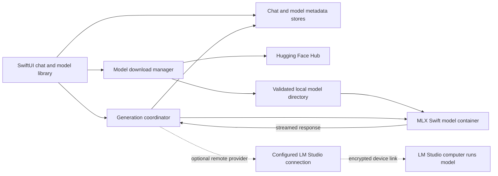

# Locally AI on iOS: Research and RAUTA Reproduction Blueprint

**Research snapshot:** September 25, 2026  
**Purpose:** document what is publicly knowable about Locally AI and provide a practical, source-backed design for a future private AI chat and local model library in RAUTA. This is research only; no application source files were changed.

Companion research: [On-Device Agentic Workflows for RAUTA on iOS](./local-agentic-workflow-ios.md) covers what a local model agent can do through app-defined tools and iOS permission boundaries.

## Executive summary

LM Studio’s iOS app is **Locally AI by LM Studio**. It began as Locally AI, an Apple-platform local-model app created by Adrien Grondin; LM Studio announced its acquisition in April 2026 and describes Locally as its mobile app. Its local path runs downloaded models on Apple devices using MLX. Its separate LM Link feature lets the phone use models hosted by a linked LM Studio computer. The app listing and release history describe model downloads, offline chat, image input, a conversation list, pinned chats, system personalization, and voice/Apple-platform integrations. ([Acquisition announcement](https://lmstudio.ai/blog/locally-ai-joins-lm-studio), [App Store listing](https://apps.apple.com/us/app/locally-ai-by-lm-studio/id6741426692), [Locally product site](https://www.locallyai.app/))

The exact Locally implementation is not public in the reviewed sources. MLX is confirmed; the app’s precise view framework, persistence schema, download manager, model-catalog service, internal model registry, and LM Link client protocol are not. The most defensible reproduction is therefore a feature-level recreation using public Apple/MLX APIs, not an attempt to guess or clone private internals.

For RAUTA, keep the feature native and offline-first: separate chat persistence from workout records, keep large model files out of JSON/UserDefaults, and put model inference behind an adapter. Build local text chat first; then add vision and voice. Treat remote inference as a separately configured extension. RAUTA already uses SwiftUI, Swift 6, an offline architecture, and file-backed versioned storage, so this can fit without replacing the workout persistence design ([project README](../../README.md), [Storage.swift](../../ios/Rauta/Rauta/Stores/Storage.swift)).

## 1. What the app is today

### Product and execution modes

| Mode | Where inference happens | Network/account needs | What to reproduce |
|---|---|---|---|
| **Local model** | On the iPhone, iPad, or Mac | Downloading/searching for a model needs internet. After a compatible model is installed, local chat can work offline and does not require sign-in. | Model catalog, download and install, device-fit guidance, local inference, and local conversation history. |
| **LM Link remote model** | On a linked computer running LM Studio | Internet is required to establish the link; the user signs into the same LM Studio account on both ends. | A separate remote-model connection and status experience. Do not present remote inference as offline/on-device. |
| **Apple Foundation Models** | Apple’s built-in model facility on compatible Apple devices/OS releases | Availability depends on Apple’s platform support; this is separate from downloading an MLX checkpoint. | Optional provider behind the same chat interface, gated by runtime availability. |

LM Studio says Locally’s LM Link connection is end-to-end encrypted using Tailscale. Its docs describe internet-assisted discovery, then communication over the encrypted device connection. The docs also note that the connection may not remain alive for long after Locally is backgrounded. LM Studio’s June 2026 announcement says chats are saved locally on the devices. ([LM Link overview](https://lmstudio.ai/docs/lmlink), [LM Link setup in Locally](https://lmstudio.ai/docs/lmlink/lmlink-in-locally), [LM Link FAQ](https://lmstudio.ai/docs/lmlink/basics/faq), [LM Studio announcement](https://lmstudio.ai/blog/locally-lm-link))

**Do not conflate LM Link with local model installation.** With LM Link, the large weights stay on the computer and that computer performs inference. With local mode, the phone downloads model files and allocates device memory for inference. The app presents both under one mobile chat experience, but they have different privacy, connectivity, memory, and lifecycle behavior.

### Current public feature inventory

The latest US App Store version history visible for this research snapshot is **1.65.0, dated September 14, 2026**. It adds support for Apple Foundation Models vision, MiniCPM 5 1B/2B, and LFM 2.5 VL 3B, and notes LM Link reliability/reconnection work. Recent entries also record Gemma 4 E2B/E4B Mobile, LFM 2.5 2.6B, Bonsai 27B on supported devices, a refreshed iOS side panel and more Liquid Glass, pinned conversations, a New Chat control, improved markdown styling, and chat scrolling fixes. Treat these as a dated snapshot: the App Store catalog and product can change after this report. ([App Store version history](https://apps.apple.com/us/app/locally-ai-by-lm-studio/id6741426692))

| Area | Publicly evidenced behavior | Reproduction implication |
|---|---|---|
| Navigation and history | iOS side panel; conversation list; New Chat; pinned conversations. | Provide fast access to recent conversations, a clear new-chat action, and pin/unpin. Persist list order and pin state. |
| Chat transcript | Multi-turn chat; release notes mention per-message model information, markdown styling, and scroll behavior during new messages. | Use structured user/assistant messages; render incrementally generated text and markdown; preserve scroll position while streaming. |
| Composer and personalization | Text composer; customizable system prompt; temperature setting; release notes mention composer improvements. | Keep prompt settings separate from transcript content and make active generation stoppable. |
| Model picker/library | Curated model families and new model entries appear in the listing/release history; model recommendations and device-limited model availability are mentioned. | Show a model’s name, format/provider, size, modalities, download state, license/source, and compatibility guidance. Exact Locally fit calculations are not public. |
| Vision | Product description says users can analyze images; latest release mentions Apple Foundation Models vision and MLX vision model additions. | Attach image data as a typed message part and only offer image input for a provider/model that supports it. |
| Voice and system integration | The product site advertises local voice mode, Siri, Shortcuts, Control Center, Lock Screen, and Action Button entry points. | These are valuable follow-on features, not prerequisites for a first chat/model-library release. Re-check platform API and app-version availability before committing to them. |
| Privacy and offline use | Store/product copy advertises on-device processing, no login for local use, and offline use after download. LM Link is a separate networked mode. | Make the selected provider and connection state obvious. Don’t send local-mode prompts to a service. Explain that discovering/downloading models is network activity. |

The App Store lists the app at about **112 MB** while marketing model downloads separately. That is a useful product clue: model weights are acquired after app installation and can be much larger than the app bundle. The listing reports iOS 18.1 or later, but an OS version alone does not guarantee that every device can run MLX or every available model. ([App Store listing and compatibility](https://apps.apple.com/us/app/locally-ai-by-lm-studio/id6741426692))

### What is confirmed, inferred, and unknown

| Confidence | Finding |
|---|---|
| **Confirmed by product sources** | The iOS/iPad app is named Locally AI by LM Studio; local models run on device; MLX is the advertised engine; the product offers offline use after model download; LM Link uses a linked LM Studio computer and Tailscale end-to-end encryption; local chat history is saved on devices. |
| **Confirmed by current release notes** | Version 1.65.0 added Apple Foundation Models vision, MiniCPM 5 1B/2B, LFM 2.5 VL 3B, and LM Link reconnection improvements. Earlier entries document chat-list, markdown, composer, model, and navigation changes. |
| **Reasonable reproduction choice, not a claim about Locally** | Implement the UI in SwiftUI, use a version-pinned MLX Swift/MLX Swift LM stack, use Hugging Face-compatible model repositories for public MLX checkpoints, and use RAUTA’s existing `Codable`/atomic-file persistence conventions for chat records. |
| **Not established publicly** | Whether Locally’s UI is SwiftUI or UIKit; whether it uses SwiftData, Core Data, SQLite, or files; its exact MLX package versions and model-serving code; the source and wire format of its curated catalog; its download retry/checksum/partial-file policy; its per-device fit thresholds; and the private LM Link mobile protocol. |

The vendor describes Locally as a native Apple-platform app and publicly names MLX, but those facts do **not** establish SwiftUI or a particular persistence/database implementation. No private implementation details should be presented as facts without a primary source.

## 2. How model discovery, installation, and inference can work

### Publicly documented model-loading building blocks

The reproducible public reference is Apple’s open-source MLX Swift stack, particularly [`mlx-swift`](https://github.com/ml-explore/mlx-swift), [`mlx-swift-lm`](https://github.com/ml-explore/mlx-swift-lm), and [MLX Swift Examples](https://github.com/ml-explore/mlx-swift-examples). The MLX Swift LM guide shows loading a model from a Hub identifier using a downloader and tokenizer loader, then using a `ChatSession`. Its current package documentation separates common LLM/VLM behavior (`MLXLMCommon`) from text and vision model implementations. Package APIs can change; pin compatible package versions and follow the migration guide when implementing.

A Hugging Face model is a repository snapshot, not one universal file. A typical MLX-compatible text model directory has a model configuration, tokenizer files, and one or more weight files, often `.safetensors`; vision-language models may also need processor/preprocessor configuration. The MLX compatibility guide recommends checking `model_type`, supported architecture, tokenizer, generation metadata/chat template, weight shards, and—when relevant—vision processors. A compatible model’s license and model card remain important: “available on Hugging Face” does not mean unrestricted use. ([MLX model compatibility](https://github.com/ml-explore/mlx-swift-lm/blob/main/Libraries/MLXLMCommon/Documentation.docc/model-compatibility.md), [MLX vision model requirements](https://github.com/ml-explore/mlx-swift-lm/blob/main/Libraries/MLXVLM/README.md), [Hugging Face model repositories](https://huggingface.co/docs/hub/models), [Hugging Face downloads](https://huggingface.co/docs/hub/models-downloading))

The package currently documents the following shape (illustrative API; pin a release before implementation):

```swift
let model = try await loadModel(
    from: downloader,
    using: tokenizerLoader,
    id: "mlx-community/Qwen3-4B-4bit"
)
let session = ChatSession(model)
let response = try await session.respond(to: prompt)
```

The same library provides lower-level model containers, structured messages, image inputs for VLMs, generation streams, and model configuration/registries. The community MLX Chat Example demonstrates a SwiftUI LLM/VLM chat, async generation, cancellation, and model switching; its maintainers describe it as an example/sandbox, not a production app. Use it to understand package wiring, not as a complete product architecture. ([MLX Swift LM usage guide](https://github.com/ml-explore/mlx-swift-lm/blob/main/Libraries/MLXLMCommon/Documentation.docc/using.md), [MLX Chat Example](https://github.com/ml-explore/mlx-swift-examples/tree/main/Applications/MLXChatExample), [LLMBasic example](https://github.com/ml-explore/mlx-swift-examples/tree/main/Applications/LLMBasic))

### Recommended on-device installation pipeline

This is an implementable design based on public MLX/Hugging Face APIs; it is **not** a claim that Locally uses these exact steps internally.

1. **Catalog entry:** store a stable model identifier and revision, display name, publisher, task/modalities, quantization, file-size estimate, license link, and supported runtime/architecture. Start with a curated registry of known-good MLX repositories rather than accepting arbitrary model URLs.
2. **Fit and consent:** compare the chosen model’s weight size and estimated runtime/context needs with the device profile and free storage. Present unsupported/large-model guidance before download. Exact VRAM/RAM thresholds used by Locally are not public; treat a fit label as an estimate, not a guarantee.
3. **Download:** retrieve the required repository snapshot and report byte progress, cancel state, and failure/retry state. Model discovery/download requires a network connection. Hugging Face’s Swift client can back the public Hub path; MLX’s downloader protocol allows replacing the downloader later.
4. **Stage and validate:** download into a temporary directory; validate the expected config, tokenizer, processor (for VLM), and weights; then atomically move the complete snapshot into the installed-model directory. Do not show a partial download as usable. Preserve the repository/revision metadata for updates and diagnostics.
5. **Load on demand:** when a chat selects the model, use the MLX model factory/container and the correct tokenizer/processor. The loader selects an implementation based on supported model configuration; a model file alone is insufficient when an architecture, chat template, or vision processor is unsupported.
6. **Generate and release memory:** run generation asynchronously and stream deltas to the chat. Support cancellation, model-switch cleanup, recoverable load/generation errors, and memory-pressure handling. Unload an inactive model before loading another unless a deliberate memory policy permits concurrency.
7. **Manage storage:** show installed size and last-used metadata; offer explicit removal that unloads first and then deletes the app-owned model directory. Keep user-created conversations when a model is removed; they are separate data.

For large downloads, Apple supports background `URLSession` downloads that can continue while an app is suspended. Model downloading should still recover cleanly if the app is terminated, the network changes, or background execution is interrupted. This is a recommendation based on the size and lifecycle of model weights, not a confirmed Locally implementation. ([Apple background downloads](https://developer.apple.com/documentation/foundation/downloading-files-in-the-background))

### Formats and compatibility boundaries

- **Choose MLX-converted checkpoints for the local iOS runtime.** MLX’s Swift model loader expects a compatible model directory and supported architecture. Do not assume that a desktop model, a `.gguf` file, or an arbitrary Hugging Face repository can be loaded by the iOS MLX backend.
- **Keep provider format explicit.** Add model metadata such as `runtime = mlx`, `format/revision`, and modalities instead of inferring compatibility from a display name.
- **Vision is model-specific.** An image-capable chat needs both an MLXVLM implementation and its processor configuration; image attachment UI alone does not make a text model multimodal.
- **Gate capabilities at runtime.** The app store’s OS minimum and the MLX Swift package’s declared iOS minimum are not device-performance guarantees. Check actual runtime/hardware support and model resource requirements; enable Apple Foundation Models only when Apple’s framework is available on that OS/device. ([MLX Swift package](https://github.com/ml-explore/mlx-swift), [Apple Foundation Models](https://developer.apple.com/documentation/foundationmodels))

## 3. Reproduction architecture for RAUTA

RAUTA currently targets iOS 27 and Swift 6, uses SwiftUI, has one existing remote package dependency (Rive), and has no backend. Its stores persist larger state as versioned JSON files under Application Support with atomic writes; small preferences use UserDefaults. Preserve these conventions and keep model weights outside the workout-state envelopes ([project README](../../README.md), [Xcode project](../../ios/Rauta/Rauta.xcodeproj/project.pbxproj), [Storage.swift](../../ios/Rauta/Rauta/Stores/Storage.swift), [TrainingRecordsStore.swift](../../ios/Rauta/Rauta/Stores/TrainingRecordsStore.swift)).

### Suggested component boundaries

| Component | Responsibility | Suggested RAUTA fit |
|---|---|---|
| `ChatFeature` / SwiftUI views | Navigation entry, conversation list, transcript, composer, model picker, download surfaces, empty/loading/error states. | Add a separately routed feature in the existing app shell. Keep workout screens and active-session flows independent. |
| `ChatStore` | Conversations, ordered messages, title, timestamps, selected provider/model, pinned state, optional system prompt. | Follow existing store style and versioned Codable JSON in Application Support; do not store large image payloads inline in one growing transcript file. |
| `ModelCatalog` | Curated model descriptions and their supported runtime, artifact location/revision, modalities, license, and fit guidance. | Use a bundled seed catalog for offline visibility and allow an optional metadata refresh; do not require an account for local models. |
| `ModelDownloadManager` | Queue, progress, cancellation, recovery, validation, installation, deletion. | Store weights as files in an app-managed model directory; store only catalog/install metadata in the chat/model index. Stage then atomically install. |
| `InferenceProvider` | Stable app-facing interface for load, stream, stop, unload, and capability reporting. | Use an actor-isolated `LocalMLXProvider` first. Separate `RemoteLMStudioProvider` and `AppleFoundationProvider` adapters only when needed. |
| `GenerationCoordinator` | One active generation per conversation, state transitions, streaming UI updates, persistence checkpoints, cancellation. | Keep heavy MLX work off SwiftUI view state; publish coalesced updates to the main actor and save transcript state at safe checkpoints. |

Suggested domain records (names are illustrative, not Locally schemas):

```text
Conversation(id, title, createdAt, updatedAt, pinned, providerID, modelID, systemPrompt?)
Message(id, conversationID, role, createdAt, parts[], generationState?, modelID?)
MessagePart = text | imageReference | generatedMetadata
ModelRecord(id, repoID, revision, runtime, capabilities, licenseURL, installedPath?, installState)
```

Keep binary image data as separate files or bounded asset records and reference them from a message. Use local IDs so deleting a model never deletes a transcript. Do not sync model weights through chat backups. If backup/export is added, make transcript export separate from the large model library.

### Data flow



The model-download path is networked, while installed-model inference and local chat history can remain on device. For an LM Link-style remote path, the computer performs generation; retain the phone’s transcript locally and represent connectivity/model availability explicitly. LM Studio documents a discovery service and Tailscale-encrypted device traffic, but does not publish a general-purpose Locally client protocol in the materials reviewed. Do not reverse engineer the private link protocol. If remote support is later required in RAUTA, use a documented LM Studio API and a separately designed secure connection, or an official supported integration if one becomes public.

### Recommended implementation sequence

1. **Runtime feasibility spike:** add a pinned MLX Swift dependency in a development branch and load one small, known-compatible quantized model on a supported physical iPhone. Confirm build integration, memory behavior, cold-load time, token streaming, cancellation, and unload. Simulators are not a substitute for device inference/performance evaluation.
2. **Local chat foundation:** add local conversation/message records, transcript rendering, composer, stream/cancel/error states, and persistence. Keep provider/model identifiers on each conversation/message for understandable history.
3. **Curated model library:** add model discovery, device-fit/size/license information, background-capable downloads, validation, install state, and explicit removal. Confirm offline chat after a successful install.
4. **Polish and multimodal:** improve markdown and scrolling; then add a separate VLM-capable model, image attachment references, and image preprocessing. Add voice/Shortcuts/Control Center integrations only after their UX and OS availability are separately scoped.
5. **Remote option:** only if wanted after local chat is stable, add an independent remote provider and explicit local/remote state. Use a documented endpoint/integration, handle reconnection/background limitations, and keep networked behavior out of local mode.

## 4. Risks, unknowns, and practical constraints

- **Model/device matrix changes.** Locally’s catalog and device-fit logic are proprietary and its model list changes through releases. Maintain a curated compatibility matrix for RAUTA and refresh it against package/model revisions; fail gracefully on unsupported architectures.
- **Memory is more than weight size.** Inference also needs tokenizer/processor data, runtime buffers, and context/KV cache. Model size and parameter count alone do not guarantee a good user experience. Bound context and generation settings for small devices and measure peak memory on-device.
- **Storage and network failure.** Model files can be multiple gigabytes. Check free disk space, support cancellation/retry, retain download state, clean abandoned staging files, and never replace a valid installed model with a partial update.
- **Background execution.** iOS may suspend the app. Background URLSession can continue file transfers, but a live remote generation connection and on-device generation have different lifecycle constraints. Persist enough state to resume the UI without promising that token generation continues after suspension.
- **Licenses and disclosures.** Each model repository has its own terms. Record and expose license/source metadata; review each model before distribution or promoting it in a curated catalog. Keep app privacy copy accurate about Hub metadata/download traffic and any future remote provider.
- **Swift 6 integration.** MLX model containers and generation are concurrency-sensitive. Keep the model/runtime isolated behind actors and convert generation events into `Sendable` values before publishing to SwiftUI state. Pin compatible dependency versions; current package APIs have undergone major-version changes.
- **App/project size and build time.** MLX adds substantial native and Metal-related dependencies. Add it only to the iOS app target, verify Xcode 27 compatibility, and assess archive size and compile time before broad integration.
- **Exact parity has a hard public-information limit.** Locally’s application source and private LM Link mobile protocol were not available in the reviewed official sources. Reproduce observable behavior and publicly documented technology, not presumed internal implementation.

## 5. Source register

Primary sources used for product facts and implementation references:

1. [Locally AI App Store listing and version history](https://apps.apple.com/us/app/locally-ai-by-lm-studio/id6741426692)
2. [Locally AI official product site](https://www.locallyai.app/)
3. [LM Studio announcement: Locally AI joins LM Studio](https://lmstudio.ai/blog/locally-ai-joins-lm-studio)
4. [LM Studio announcement: LM Link in Locally](https://lmstudio.ai/blog/locally-lm-link)
5. [LM Link overview](https://lmstudio.ai/docs/lmlink)
6. [LM Link in Locally setup and FAQ](https://lmstudio.ai/docs/lmlink/lmlink-in-locally)
7. [LM Link security and connectivity FAQ](https://lmstudio.ai/docs/lmlink/basics/faq)
8. [Apple MLX Swift](https://github.com/ml-explore/mlx-swift)
9. [Apple MLX Swift LM](https://github.com/ml-explore/mlx-swift-lm)
10. [MLX Swift LM: using models](https://github.com/ml-explore/mlx-swift-lm/blob/main/Libraries/MLXLMCommon/Documentation.docc/using.md)
11. [MLX Swift LM: model compatibility](https://github.com/ml-explore/mlx-swift-lm/blob/main/Libraries/MLXLMCommon/Documentation.docc/model-compatibility.md)
12. [MLX Swift LM: VLM model notes](https://github.com/ml-explore/mlx-swift-lm/blob/main/Libraries/MLXVLM/README.md)
13. [MLX Swift Examples: MLX Chat Example](https://github.com/ml-explore/mlx-swift-examples/tree/main/Applications/MLXChatExample)
14. [Hugging Face Hub: models](https://huggingface.co/docs/hub/models)
15. [Hugging Face Hub: downloading models](https://huggingface.co/docs/hub/models-downloading)
16. [Apple Developer: background file downloads](https://developer.apple.com/documentation/foundation/downloading-files-in-the-background)
17. [Apple Developer: Foundation Models](https://developer.apple.com/documentation/foundationmodels)

RAUTA architecture context was read from the repository’s [README](../../README.md), [Storage.swift](../../ios/Rauta/Rauta/Stores/Storage.swift), [TrainingRecordsStore.swift](../../ios/Rauta/Rauta/Stores/TrainingRecordsStore.swift), and [Xcode project](../../ios/Rauta/Rauta.xcodeproj/project.pbxproj). Existing unrelated working-tree changes were left untouched.
